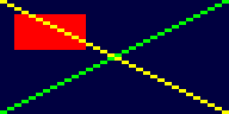
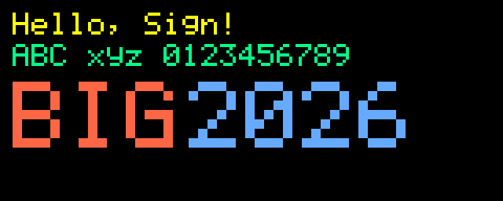
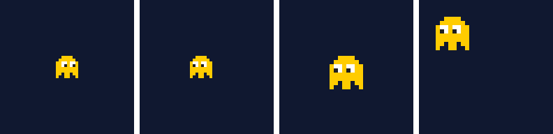
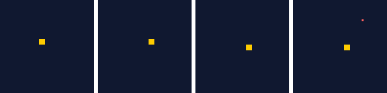
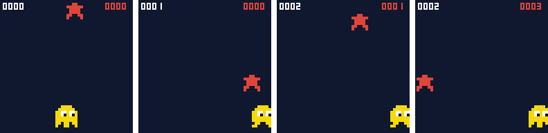
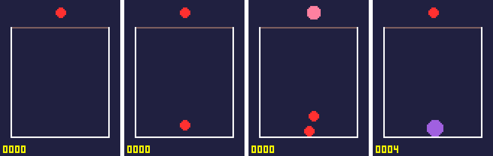
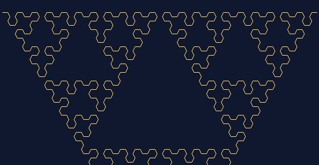
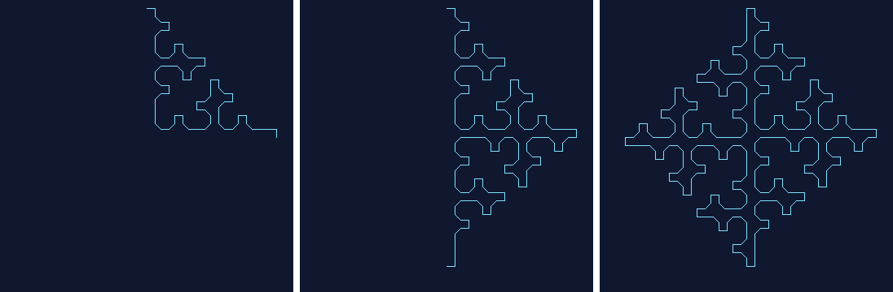

# Sign で作る — 描画とゲーム

Nov 3, 2026 · @たににゃん

## 目次

- [はじめに](#m1beqaqe2vb.30)
- [第1章 絵を描く](#m1beqaqe2vb.872)
  - [レシピ1 文字で円を描く](#m1beqaqe2vb.933)
  - [レシピ2 画面に線と四角を描く](#m1beqaqe2vb.2649)
- [第2章 文字とスプライト](#m1beqaqe2vb.4037)
  - [レシピ3 画面に文字を書く](#m1beqaqe2vb.4104)
  - [レシピ4 スプライトを置いて動かす](#m1beqaqe2vb.4975)
- [第3章 動かす・操作する](#m1beqaqe2vb.7606)
  - [レシピ5 四角を右へ動かす](#m1beqaqe2vb.7718)
  - [レシピ6 キーとクリックに反応する](#m1beqaqe2vb.8832)
- [第4章 ゲームを動かす](#m1beqaqe2vb.11355)
  - [レシピ7 星を受け止めるゲーム](#m1beqaqe2vb.11510)
  - [レシピ8 スイカゲームを動かす](#m1beqaqe2vb.12586)
- [第5章 亀で曲線を描く](#m1beqaqe2vb.16114)
  - [レシピ9 シェルピンスキーの矢じり曲線](#m1beqaqe2vb.16273)
  - [レシピ10 四角いシェルピンスキー曲線を動かす](#m1beqaqe2vb.18386)
- [付録 実行するコマンドの一覧](#m1beqaqe2vb.13778)

## はじめに

この巻は、Sign で絵を描き、動かし、ゲームにするレシピ集です。『動くレシピ集』『ネットワークと保存』の続きですが、単独でも読めます。文法の説明は『Sign入門』に任せ、ここでは動くコードと結果を並べます。

各レシピは「やりたいこと、全コード、実行結果、ひとこと」の順です。コードは実際に動かして結果を取っています。実行は既定のモードで行い、確かめた版は「alpha1 実装 2026-11-06 00:50 JST」です。

コマンドは、bash で打つ形で書いています。確かめたのは Linux の上だけで、Windows や macOS では試していません。

結果の出どころは、入れた印で区別します。

- **【仕様】** 配布された仕様書に書かれている動作です。この巻では、メモリの番地を `#` で書き `@` で読む動作がこれにあたります。
- **【実装】** `sign_interp.py` がそう動くだけで、仕様書に見つからない動作です。別の処理系では同じになるとは限りません。
- **【拡張】** 仕様に無い、この実装に添えた道具です。

画面、タイマー、入力の「窓口」(座標や命令を書く番地)と、文字を描く `font.sn`、ゲーム機 `sign_console.py` は、すべて【拡張】です。仕様にある `#` と `@` で窓口の番地を読み書きするので、仕組みは仕様の上に載っています。ただし、ほかの処理系で同じ番地の装置が使えるとは限りません。

**確かめた範囲** 確かめたパソコンには画面が無かったので、窓(`--display=window`)は開いていません。代わりに、絵を PNG に保存する練習用の画面(`--display=png:…`)と、キー・マウスを台本で流し込む `--input=` を使い、出てきた絵を目で確かめました。本物の窓での操作感や速さ、音は確かめていません。掲載の画像は、確かめた PNG を見やすい大きさに拡大し、必要なところを並べたものです。

印の無い記述は、ゲームやツールのルール、動かして見た結果の説明です。仕様書との一致を示すのは【仕様】の印だけです。Sign の資料は [johnny-shaman/Sign](https://github.com/johnny-shaman/Sign) にあり、仕様書に無い話は [Discussions](https://github.com/johnny-shaman/Sign/discussions) に出てきます。

## 第1章 絵を描く

この章は、絵を 2 通りの方法で描きます。先は文字で、次は画面の「窓口」を使って、線と四角を描きます。

### レシピ1 文字で円を描く

**やりたいこと**: 41 文字×21 行の紙に、円を `#` で描きます。円の外側は `.` にします。

コードは、配布物の `draw_circle.sn` の先頭の説明を省いたものです。

```
out : 0x9000000

W : 41
H : 21
newline : 0u000A

`--- 1 画素。円の内側は # 、外側は . ---`

pixel : x y ?
	(x - 20) * (x - 20) + (y - 10) * (y - 10) * 4 <= 400 : \#
	\.

`--- 1 行。x を 0 から W まで進める ---`

row : y x ?
	x >= W : out # newline
	out # (pixel x y) : row y (x + 1)

`--- 全体。y を 0 から H まで進める ---`

draw : y ?
	y >= H : y
	row y 0 : draw (y + 1)

draw 0
```

`draw_circle.sn` として保存し、実行します。画面の装置は要りません。

```
python3 sign_interp.py draw_circle.sn
```

実行結果は次のとおりです。

```
....................#....................
............#################............
........#########################........
......#############################......
....#################################....
...###################################...
..#####################################..
.#######################################.
.#######################################.
.#######################################.
#########################################
.#######################################.
.#######################################.
.#######################################.
..#####################################..
...###################################...
....#################################....
......#############################......
........#########################........
............#################............
....................#....................
21
```

**ひとこと**: `out # 文字` という書き込みで、文字が標準出力に出ます。`0x9000000` への書き込みが文字の出力になるのは、仕様書の説明には見つからず(配布された emit.sn は同じ番地へ文字を書いていますが、これはサンプルです)、この実装の動きです【実装】。`#` と `@` は仕様にある演算子です【仕様】。`0u000A` は改行の文字、`\#` と `\.` は 1 文字を表す書き方です。縦の距離を 4 倍しているのは、文字の縦が横より長いので、見た目を円にするためです。繰り返しは「効果を条件に書いた行から自分を呼ぶ」形です(`row`、`draw`)。

結果の最後の `21` は、プログラムの最後の式 `draw 0` の値(縦の行数)です。最後の式の値を出すのは【実装】です。

### レシピ2 画面に線と四角を描く

**やりたいこと**: 64×32 画素の画面を紺色で塗り、赤い四角と 2 本の線を描いて、PNG に保存します。

描画装置は、メモリの番地 `0x9100000` から始まる「窓口」です【拡張】。色や座標を窓口の決まった番地へ置いてから、命令の番地へ命令の番号を書くと、その瞬間に実行されます【拡張】。コードは、配布物の `draw_gfx.sn` の先頭の説明を省いたものです。

```
gfx : 0x9100000

width : gfx + 0x00
height : gfx + 0x04
color : gfx + 0x08
px : gfx + 0x0C
py : gfx + 0x10
cmd : gfx + 0x14
arg0 : gfx + 0x18
arg1 : gfx + 0x1C

plot_cmd : 1
clear_cmd : 2
present_cmd : 3
line_cmd : 4
rect_cmd : 5

`--- 命令。値を置いてから CMD を書く ---`

clear : c ? seq2 (color # c) (cmd # clear_cmd)
rect : x y w h c ? seq8 (color # c) (px # x) (py # y) (arg0 # w) (arg1 # h) (cmd # rect_cmd) 0 0
line : x y x2 y2 c ? seq8 (color # c) (px # x) (py # y) (arg0 # x2) (arg1 # y2) (cmd # line_cmd) 0 0
present : z ? cmd # present_cmd

seq2 : a b ? b
seq8 : a b c d e f g h ? h

clear 0x000040
rect 4 4 20 10 0xFF0000
line 0 0 63 31 0xFFFF00
line 0 31 63 0 0x00FF00
present 0
```

`draw_gfx.sn` として保存し、画面の装置を 64×32 画素、保存先 `gfx.png` で付けて実行します。

```
python3 sign_interp.py draw_gfx.sn --display=png:gfx.png:64x32
```

実行すると `gfx.png` ができ、画面には `152043540` と出ました。できた絵は次のとおりです(64×32 の絵を 6 倍に拡大しています)。



**ひとこと**: 「色を置く、座標を置く、CMD を書く」が 1 回の描き方です。命令の番号は、`1` が点、`2` が全面を塗る、`3` が画面を外へ出す(PRESENT)、`4` が線、`5` が四角です【拡張】。色は `0xRRGGBB` です。`present` を呼ばないと、絵はファイルに出ません。最後の `152043540`(16 進で `0x9100014`)は、最後の式 `cmd # present_cmd` が返す、書き込んだ番地です。`#` が書いた番地を返すのは【仕様】、それを画面に出すのは【実装】です。線と四角の重なりは、後に描いたものが上に来ます(絵では黄の線が四角の上に見えます)。範囲外の座標に描くと、黙って捨てられます【拡張】。

## 第2章 文字とスプライト

この章は、画面に文字を書き、キャラクターの絵(スプライト)を置きます。第1章の「窓口」をそのまま使います。

### レシピ3 画面に文字を書く

**やりたいこと**: 160×64 画素の画面に、文字と数字をいくつかの大きさ・色で書きます。

文字は、配布物の `font.sn` が描きます【拡張】。5×7 画素の ASCII の字形を Sign で書いたもので、日本語はありません。コードは、配布物の `font_demo.sn` の先頭の説明を省いた 1 行だけです。`font.sn` と `std.sn` は同じフォルダに置きます。

```
`font.sn`@~

seq5 (font_print `Hello, Sign!` 4 4 1 0xFFFF00) (font_print `ABC xyz 0123456789` 4 14 1 0x00FF88) (font_print `BIG` 4 26 3 0xFF6644) (font_int 2026 60 26 3 0x66AAFF) ((0x9100000 + 0x14) # 3)
```

`font_demo.sn` として保存し、画面を 160×64 画素で付けて実行します。

```
python3 sign_interp.py font_demo.sn --display=png:font_demo.png:160x64
```

実行すると `font_demo.png` ができ、画面には `152043540` と出ました。できた絵は次のとおりです(4 倍に拡大しています)。



**ひとこと**: `font_print 文字列 x y 倍率 色` が、Sign の文字列(バッククォートで囲んだもの)をそのまま描きます。`font_int` は整数を 10 進で描きます。倍率は 1 から 64 で、文字 1 つの送りは幅 6×倍率、行の送りは 8×倍率です【拡張】。5 つの式を `seq5` で順に評価し、最後に画面を外へ出す命令(番地 `0x9100000 + 0x14` へ `3`)を書いています。`seq5` は `std.sn` にある関数です【拡張】。絵の最後に出た `152043540` は、第1章と同じく最後の式の値(書いた番地)です【実装】。

### レシピ4 スプライトを置いて動かす

**やりたいこと**: 8×8 画素のおばけの絵を画面に置き、左右キーで動かして向きを変え、上下キーで拡大し、クリックした位置へ移します。

スプライトは、絵を 1 画素 1 語(`0xRRGGBB`)でメモリに並べておき、描画装置の BLIT(命令 6)で一度に描くものです【拡張】。置かなかった語は透明になり、位置・拡大・向きを命令で指定できます。コードは、配布物の `sprite_demo.sn` の先頭の説明を省いたものです。

```
`絵は 1 画素 1 語(0xRRGGBB)で番地 IMG に置く。置かなかった語(.)は透明。装置の BLIT(命令 6)で、位置 (X,Y)・大きさ・拡大・向きを指定して一度に描く。`

gfx : 0x9100000
color : gfx + 0x08
px : gfx + 0x0C
py : gfx + 0x10
cmd : gfx + 0x14
arg0 : gfx + 0x18
arg1 : gfx + 0x1C
src : gfx + 0x28
scale : gfx + 0x30
flip : gfx + 0x34

seq2 : a b ? b
seq3 : a b c ? c
seq4 : a b c d ? d
seq5 : a b c d e ? e
seq8 : a b c d e f g h ? h

IMG : 0x600000
X : 0x3000
Y : 0x3004
S : 0x3008
FL : 0x300C
get : a ? @a

`絵(8×8)。# は黄、o は白、@ は黒、. は透明`
ART : [`..####..` , `.######.` , `##oo#oo#` , `##o@#o@#` , `########` , `########` , `##.##.##` , `#..##..#`]

`文字 → 色。透明(__)は書かない`
colorof : ch ?
	ch = 0u23 : 0xFFCC00
	ch = 0u6F : 0xFFFFFF
	ch = 0u40 : 0x202020
	__

lrow : r s i ?
	i >= ||s|| : 0
	seq2 (((IMG + (((r * 8) + i) * 4)) # (colorof (s ' i))) | 0) (lrow r s (i + 1))

lart : r ?
	r >= 8 : 0
	seq2 (lrow r (ART ' r) 0) (lart (r + 1))

clear : c ? seq2 (color # c) (cmd # 2)
present : z ? cmd # 3

draw : z ? seq8 (px # (get X)) (py # (get Y)) (arg0 # 8) (arg1 # 8) (src # IMG) (scale # (get S)) (flip # (get FL)) (cmd # 6)

clampv : v lo hi ?
	v < lo : lo
	v > hi : hi
	v

on_key : code ?
	code = 28 : seq2 (X # (clampv ((get X) - 4) 0 88)) (FL # 1)
	code = 29 : seq2 (X # (clampv ((get X) + 4) 0 88)) (FL # 0)
	code = 30 : S # (clampv ((get S) + 1) 1 6)
	code = 31 : S # (clampv ((get S) - 1) 1 6)
	code = 113 : 0 - 1
	0

on_click : x y b ? seq3 (X # (clampv (x - 8) 0 88)) (Y # (clampv (y - 8) 0 88)) 0

init : z ? seq5 (lart 0) (X # 40) (Y # 40) (S # 2) (FL # 0)

tick : z ? seq3 (clear 0x101830) (draw 0) (present 0)
```

`sprite_demo.sn` として保存します。このプログラムは、この巻の第3章で使うゲーム機(`sign_console.py`)で動かします。本当は窓を開いて `--display=window:5:96x96` で遊びますが、ここでは窓を開かず、PNG を 1 こまずつ保存する練習用の画面と、キーとマウスの台本で確かめました。台本は「ミリ秒:種類:…」をコンマで並べます(`kd` がキー押す、`ku` が離す、`md` がマウス押す、`mu` が離す)【拡張】。

```
python3 sign_console.py sprite_demo.sn --display=png:sp{n}.png:96x96 --timer=virtual --frames=45 --fps=60 --input=100:kd:28,110:ku:28,300:kd:30,310:ku:30,500:md:1:20:20,510:mu:1:20:20
```

45 こま分を走らせると `sp1.png` から `sp45.png` の 45 枚ができました。うち 1、13、31、45 枚目を並べたのが次の絵です(2 倍に拡大しています)。左から順に、最初、左キーを押した後、上キーを押した後、クリックした後です。



**ひとこと**: 1 枚目では (40, 40) に大きさ 2 でいたおばけが、13 枚目では (36, 40) で向きが反転していました(目の黒い点が右寄りから左寄りに変わっています)。31 枚目では大きさ 3 になり、45 枚目ではクリックした位置 (20, 20) から 8 を引いた (12, 12) を左上にして置いています。絵は `ART` の文字の並びを、`colorof` で色に直してメモリへ置いています。置かない語は透明になるので、`__` を返す `colorof` の最後の行で間に合います【拡張】。`on_key` と `on_click` を定義すると、ゲーム機が出来事を古い順に呼び、そのあと `tick` を呼びます【拡張】。

## 第3章 動かす・操作する

この章は、絵を時間で動かし、キーやマウスに反応させます。時間の装置(タイマー、基点 `0x9200000`)と入力の装置(基点 `0x9300000`)も、第1章の描画装置と同じ「窓口」の形です【拡張】。

### レシピ5 四角を右へ動かす

**やりたいこと**: 白い四角を 6 画素ずつ右へ、描いて、見せて、待つを繰り返して動かします。

コードは、配布物の `animate.sn` の先頭の説明を省いたものです。

```
gfx : 0x9100000
timer : 0x9200000

color : gfx + 0x08
px : gfx + 0x0C
py : gfx + 0x10
cmd : gfx + 0x14
arg0 : gfx + 0x18
arg1 : gfx + 0x1C
now : timer + 0x00
sleep : timer + 0x04

seq2 : a b ? b
seq3 : a b c ? c
seq8 : a b c d e f g h ? h

clear : c ? seq2 (color # c) (cmd # 2)
rect : x y w h c ? seq8 (color # c) (px # x) (py # y) (arg0 # w) (arg1 # h) (cmd # 5) 0 0
present : z ? cmd # 3
wait : ms ? sleep # ms

`--- 1 こま。x の位置に四角を描き、50ms 待って次へ ---`

frame : x ?
	x >= 24 : x
	seq3 (clear 0) (rect x 4 8 8 0xFFFFFF) (present 0) : seq2 (wait 50) (frame (x + 6))

frame 0
@now
```

`animate.sn` として保存し、`{n}` を入れたファイル名で画面を付けて実行します。`{n}` は、画面を外へ出す命令を呼ぶたびに番号に変わり、コマ送りの絵が 1 枚ずつ残ります【拡張】。

```
python3 sign_interp.py animate.sn --display=png:anim{n}.png:64x32
```

`anim1.png` から `anim4.png` の 4 枚ができ、画面には最後の式 `@now` の値 `212` と出ました。この数は起動からの経過ミリ秒で、実行するたびに少し違います。4 枚を並べると次のとおりです(3 倍に拡大しています)。


**ひとこと**: `sleep # 50` と書くと、「50 ミリ秒待つ」命令になります【拡張】。`frame` は、「描いて見せる」を条件の行に書き、成功したら待って次のこまへ進む形です。`x >= 24` で終わるので、四角は x = 0、6、12、18 の 4 回だけ現れます。`#` と `@` は仕様にある演算子です【仕様】。

### レシピ6 キーとクリックに反応する

**やりたいこと**: 矢印キーで四角を 1 マスずつ動かし、クリックした位置に点を打ち、`c` で点を消し、`q` で終わります。

このプログラムは、ゲーム機 `sign_console.py` で動かします【拡張】。ゲーム機への約束は次の 3 つです。

- `tick : z ? …` を定義する。ゲーム機が 1 秒に指定回数(既定は 60 回)呼び、`-1` を返すと終わる。
- `init : z ? …` を定義しておくと、始めに 1 回だけ呼ぶ(省いてよい)。
- `on_key : code ?`、`on_click : x y button ?` などを定義すると、このこまの頭で、たまった出来事を古い順に呼んでから `tick` を呼ぶ。どれも `-1` を返すと終わる。

コードは、配布物の `events_demo.sn` の先頭の説明を省いたものです。

```
SIZE : 6
STEP : 6
BG : 0x101830

gfx : 0x9100000
color : gfx + 0x08
px : gfx + 0x0C
py : gfx + 0x10
cmd : gfx + 0x14
arg0 : gfx + 0x18
arg1 : gfx + 0x1C

seq2 : a b ? b
seq3 : a b c ? c
seq4 : a b c d ? d
seq5 : a b c d e ? e
seq8 : a b c d e f g h ? h

`状態は番地に置く: 四角の位置、点の数、点の座標の並び`
X : 0x3000
Y : 0x3004
NP : 0x3008
DOTS : 0x4000
get : a ? @a

clear : c ? seq2 (color # c) (cmd # 2)
rect : x y w h c ? seq8 (color # c) (px # x) (py # y) (arg0 # w) (arg1 # h) (cmd # 5) 0 0
present : z ? cmd # 3

clamp : v hi ?
	v < 0 : 0
	v > hi : hi
	v

`--- イベント: キーが押されたとき(1 回だけ)。左 28 右 29 上 30 下 31、c は 99、q は 113 ---`
on_key : code ?
	code = 28 : X # (clamp ((get X) - STEP) 90)
	code = 29 : X # (clamp ((get X) + STEP) 90)
	code = 30 : Y # (clamp ((get Y) - STEP) 90)
	code = 31 : Y # (clamp ((get Y) + STEP) 90)
	code = 99 : NP # 0
	code = 113 : 0 - 1
	0

`--- イベント: クリックされたとき。点の座標を覚える(上限 100 こ) ---`
on_click : x y button ?
	(get NP) >= 100 : 0
	seq4 ((DOTS + ((get NP) * 8)) # x) ((DOTS + ((get NP) * 8) + 4) # y) (NP # ((get NP) + 1)) 0

dots : i ?
	i >= (get NP) : 0
	seq2 (rect (get (DOTS + (i * 8))) (get (DOTS + (i * 8) + 4)) 2 2 0xFF6060) (dots (i + 1))

init : z ? seq3 (X # 40) (Y # 40) (NP # 0)

tick : z ? seq4 (clear BG) (dots 0) (rect (get X) (get Y) SIZE SIZE 0xFFCC00) (present 0)
```

`events_demo.sn` として保存します。本当は `--display=window:5:96x96` で窓を開いて遊びますが、ここでは窓を開かず、台本で確かめました。右キーを 2 回、下キーを 1 回押し、最後に (70, 20) をクリックする台本です。

```
python3 sign_console.py events_demo.sn --display=png:ev{n}.png:96x96 --timer=virtual --frames=40 --fps=60 --input=100:kd:29,110:ku:29,200:kd:29,210:ku:29,300:kd:31,310:ku:31,400:md:1:70:20,410:mu:1:70:20
```

40 こま分を走らせると `ev1.png` から `ev40.png` の 40 枚ができました。うち 1、15、25、40 枚目を並べたのが次の絵です(2 倍に拡大しています)。



**ひとこと**: 四角の位置や点の座標を、関数の引数ではなくメモリの番地(`X`、`Y`、`NP`、`DOTS`)に置いているのが、ゲーム機の作法です。`tick` や `on_key` を呼ぶたびに関数の中の変数は消えるので、次のこまへ渡すものはメモリへ置きます。この `#` と `@` の使い方は仕様にある演算子です【仕様】。キーの番号は、左 28、右 29、上 30、下 31、文字は ASCII(c が 99、q が 113)です【拡張】。

気をつける点が 1 つあります。ゲーム機は、ファイルの中の「定義」(`名前 : …` の行)だけを読みます。続きに `ss 0 0` のような定義でない行を書くと、「定義でない行が N あります(読みません)」と注意が出て、その行は動きません【拡張】。初めの値は `init` に書きます。この章では、`animate.sn` だけが「定義でない行」(`frame 0` と `@now`)を持ち、`sign_interp.py` で動かしました。

## 第4章 ゲームを動かす

この章は、配布物のゲーム 2 本を動かして、作り方を読みとります。`star_catch.sn` は 184 行、`suika.sn` は 614 行と長いので、全コードは載せず、動かし方と見どころを書きます。第3章で見た窓口の番地の使い方は、どちらにもそのまま出てきます。`tick` と `init` は `star_catch.sn` がゲーム機の約束どおりに使っていて、`suika.sn` は `tick` を持ちますが、ゲーム機ではなく自分のループから呼んでいます【拡張】。

### レシピ7 星を受け止めるゲーム

**やりたいこと**: おばけを左右のキーで動かして、落ちてくる星を受け止めます。受け止めたら「点」が増え、受け損なって画面の下へ消えたら「ミス」が増えます。

`star_catch.sn` は、ブロックを積んでゲームを作るエディタ(`sign_scratch.html`)が作ったものです【拡張】。窓を開いて遊ぶには、次のように実行します。

```
python3 sign_console.py star_catch.sn --display=window:5:96x96
```

ここでは窓を開かず、台本で確かめました。500 ミリ秒で右キーを押し、押したままにして、2000 ミリ秒で左キーを押す台本です。

```
python3 sign_console.py star_catch.sn --display=png:st{n}.png:96x96 --timer=virtual --frames=900 --fps=60 --input=500:kd:29,2000:kd:28
```

900 こまを走らせるように指定しましたが、311 こま目でゲームが自分で止まり、`st1.png` から `st311.png` の 311 枚ができました。このうち 1、60、120、240 枚目を並べたのが次の絵です(2 倍に拡大しています)。左上の白い数字が「点」、右上の赤い数字が「ミス」です。



絵では、点は 0000、0001、0002、0002、ミスは 0000、0000、0001、0003 でした。

**ひとこと**: ブロックの設計図(`star_catch.json`)を読むと、毎こまの `tick` は次の順です。

1. 時間 `t` を 1 進める。
2. 左キーが押されていておばけの x が 0 より大きければ 3 画素左へ、右キーが押されていて x が 80 より小さければ 3 画素右へ動かし、どちらでも絵の向きもそろえる。
3. `t` を 8 で割った余りが 0 のこまにだけ、おばけの絵を次の絵に切り替える。
4. 星を毎こま 2 画素下へ動かす。
5. おばけと星が触れたら「点」を 1 増やし、星を上の端のランダムな横の位置へ戻す。星の y が 96 より大きくなったら「ミス」を 1 増やし、同じように戻す。
6. 画面を消して、星、おばけ、点とミスの数字を描く。
7. ミスが 5 以上なら止める。

「ミスが 5 で止まる」はこの設計図どおりで、台本でも 311 こま目で止まりました。このゲームは、キーの「押しっぱなし」を毎こま調べているので、第3章の「押すたび 1 回」の `on_key` と違い、押した間ずっと動き続けます。ブロックから `.sn` を作る仕組みは、この巻では確かめていません(第5巻で確かめました)。

### レシピ8 スイカゲームを動かす

**やりたいこと**: 果物を左右のキーで位置を決め、スペースで落とします。同じ果物が触れると 1 つ大きい果物になり、得点が増えます。

`suika.sn` は、第3章のゲーム機ではなく `sign_interp.py` で直接動かします。ファイルの先頭の説明どおり、窓を開くには次のように実行します。

```
python3 sign_interp.py suika.sn --display=window:5:80x104 --timer
```

ここでは窓を開かず、スペースで落とし、右キー・左キーで位置を変えてまた落とす台本で確かめました。終わりは `q` を押す台本にしています。

```
python3 sign_interp.py suika.sn --display=png:sk{n}.png:80x104 --timer=virtual --input=200:kd:32,210:ku:32,700:kd:29,710:ku:29,900:kd:32,910:ku:32,1500:kd:28,1510:ku:28,1700:kd:32,1710:ku:32,2500:kd:q,2510:ku:q
```

`sk1.png` から `sk62.png` の 62 枚ができ、画面には最後の式の値 `4` と出ました。うち 1、20、40、62 枚目を並べたのが次の絵です(3 倍に拡大しています)。



**ひとこと**: 果物が落ち、積み重なり、最後の枚では大きな紫の果物になって、得点の数字が `0004` になりました。このゲームは、得点を三角数(段が上がる合体で 1、3、6・・・)で数えるとファイルの中に書いてあり、`0004` はその組み合わせと読めますが、ここでは合体の回数までは確かめていません。このファイルは、ループを末尾再帰で書いているので、遊ぶ長さに上限は無いと先頭の説明にあります。長時間遊んでは確かめていません。

終わりの条件は、果物が上の線より上に 45 こま続けて出ているとゲームオーバーです(ファイルの先頭の説明による)。この台本ではこれには当たらず、ゲームオーバーの画面は確かめていません。

## 第5章 亀で曲線を描く

この章は、第1章の線の命令を重ねて、「亀」(タートルグラフィック)の命令で曲線を描きます。亀の位置(x と y)と向き、線の色は、特別な仕組みではなく、ふつうのメモリの番地(`0x100`、`0x104`、`0x108`、`0x10C`)に置きます。`#` と `@` で書いて読むだけで、新しい道具は出てきません。

### レシピ9 シェルピンスキーの矢じり曲線

**やりたいこと**: 亀を歩かせて線を引き、六つの向き(60 度刻み)で、三角形がいくつも入れ子になった曲線を 1 枚の絵に描きます。

コードは、配布物の `turtle_sierpinski.sn` の先頭の説明を省いたものです。

```
gfx : 0x9100000
color : gfx + 0x08
px : gfx + 0x0C
py : gfx + 0x10
cmd : gfx + 0x14
arg0 : gfx + 0x18
arg1 : gfx + 0x1C

seq2 : a b ? b
seq3 : a b c ? c
seq5 : a b c d e ? e
seq8 : a b c d e f g h ? h

`--- 亀の状態 ---`

tx : 0x100
ty : 0x104
th : 0x108
ink : 0x10C

`--- 向きごとの 1 歩(長さ 8 の六角格子。dy は 8 × 0.866 ≒ 7) ---`

dx : h ?
	h = 0 : 8
	h = 1 : 4
	h = 2 : 0 - 4
	h = 3 : 0 - 8
	h = 4 : 0 - 4
	4

dy : h ?
	h = 0 : 0
	h = 1 : 0 - 7
	h = 2 : 0 - 7
	h = 3 : 0
	h = 4 : 7
	7

`--- 描画装置 ---`

clear : c ? seq2 (color # c) (cmd # 2)
line : x y x2 y2 c ? seq8 (color # c) (px # x) (py # y) (arg0 # x2) (arg1 # y2) (cmd # 4) 0 0
present : z ? cmd # 3

`--- タートルの命令 ---`

wrap : h ?
	h < 0 : h + 6
	h >= 6 : h - 6
	h

home : x y h c ? seq5 (tx # x) (ty # y) (th # h) (ink # c) 0
turn : d ? th # (wrap ((@th) + d))
goto : x y ? seq3 (line (@tx) (@ty) x y (@ink)) (tx # x) (ty # y)
forward : n ? goto ((@tx) + (dx (@th)) * n) ((@ty) + (dy (@th)) * n)
left : z ? turn 1
right : z ? turn 5

`--- シェルピンスキーの矢じり曲線。A と B が互いを呼ぶ(順序は関係ない) ---`

arrow_a : n ?
	n = 0 : forward 1
	seq5 (arrow_b (n - 1)) (left 0) (arrow_a (n - 1)) (left 0) (arrow_b (n - 1))

arrow_b : n ?
	n = 0 : forward 1
	seq5 (arrow_a (n - 1)) (right 0) (arrow_b (n - 1)) (right 0) (arrow_a (n - 1))

`--- 描く。次数は偶数なら向きが戻り、底辺が水平に出る ---`

clear 0x101830
home 4 20 0 0xFFD060
arrow_a 6
present 0
```

`turtle_sierpinski.sn` として保存し、画面を `sierpinski.png` で付けて実行します。

```
python3 sign_interp.py turtle_sierpinski.sn --display=png:sierpinski.png:520x270
```

実行すると `sierpinski.png` ができ、画面には `152043540` と出ました。できた絵は次のとおりです。



**ひとこと**: 亀の状態は、4 つの番地にふつうに置いています。`forward` は、いまの向きの 1 歩を表(`dx` と `dy`)から引いて、今の位置から次の位置まで `line` で線を引き、位置を書き換えます。向きは 0 から 5 までの数で、`wrap` が 6 で 0 に戻します。三角関数は使わず、1 歩の動きは表にしてあります。`arrow_a` と `arrow_b` は、お互いを呼び合っています。Sign では定義の順序は関係ないので、どちらを先に書いても動きます。`forward ((@tx) + (dx (@th)) * n)` のように、演算子の相手に置く関数の呼び出し(`dx (@th)`)は括弧でくくっています。`152043540` は、最後の式 `cmd # present` が返す書き込んだ番地で、第1章と同じです。

**確かめていないこと**: 次数(`arrow_a 6` の `6`)を変えたときの絵と、窓(`--display=window:…`)で動かす操作は、確かめていません。

### レシピ10 四角いシェルピンスキー曲線を動かす

**やりたいこと**: 同じ亀で、向きを 8 つ(45 度刻み)にして、四角いシェルピンスキー曲線を描きます。1 歩ごとに画面を見せて、線が伸びていくところを動画のようにします。

コードは、配布物の `turtle_square_anim.sn` の先頭の説明を省いたものです。レシピ9 との違いは、向きの数(8)と、`forward` のあとに `show` を呼んで、1 歩ごとに画面を見せて待つところです。

```
frame_ms : 8
order : 3

gfx : 0x9100000
timer : 0x9200000
color : gfx + 0x08
px : gfx + 0x0C
py : gfx + 0x10
cmd : gfx + 0x14
arg0 : gfx + 0x18
arg1 : gfx + 0x1C
sleep : timer + 0x04

seq2 : a b ? b
seq3 : a b c ? c
seq5 : a b c d e ? e
seq7 : a b c d e f g ? g
seq8 : a b c d e f g h ? h
seq9 : a b c d e f g h i ? i

`--- 亀の状態 ---`

tx : 0x100
ty : 0x104
th : 0x108
ink : 0x10C

`--- 向きごとの 1 歩。軸は 10、斜めは (7,7)(10÷√2 ≒ 7) ---`

dx : h ?
	h = 0 : 10
	h = 1 : 7
	h = 2 : 0
	h = 3 : 0 - 7
	h = 4 : 0 - 10
	h = 5 : 0 - 7
	h = 6 : 0
	7

dy : h ?
	h = 0 : 0
	h = 1 : 0 - 7
	h = 2 : 0 - 10
	h = 3 : 0 - 7
	h = 4 : 0
	h = 5 : 7
	h = 6 : 10
	7

`--- 描画装置 ---`

clear : c ? seq2 (color # c) (cmd # 2)
line : x y x2 y2 c ? seq8 (color # c) (px # x) (py # y) (arg0 # x2) (arg1 # y2) (cmd # 4) 0 0
present : z ? cmd # 3
show : z ?
	frame_ms > 0 : seq2 (present 0) (sleep # frame_ms)
	0

`--- タートルの命令 ---`

wrap : h ?
	h < 0 : h + 8
	h >= 8 : h - 8
	h

home : x y h c ? seq5 (tx # x) (ty # y) (th # h) (ink # c) 0
turn : d ? th # (wrap ((@th) + d))
goto : x y ? seq3 (line (@tx) (@ty) x y (@ink)) (tx # x) (ty # y)
forward : n ? seq2 (goto ((@tx) + (dx (@th)) * n) ((@ty) + (dy (@th)) * n)) (show 0)
left : z ? turn 1
right : z ? turn 7
quarter : z ? turn 6

`--- 曲線。part m は XF+G+XF 、 sq_x n は X の n 段の展開 ---`

part : m ? seq7 (sq_x m) (forward 1) (left 0) (forward 1) (left 0) (sq_x m) (forward 1)

sq_x : n ?
	n = 0 : 0
	seq5 (part (n - 1)) (quarter 0) (forward 1) (quarter 0) (part (n - 1))

`--- F--XF--F--XF ---`

curve : n ? seq9 (forward 1) (quarter 0) (sq_x n) (forward 1) (quarter 0) (forward 1) (quarter 0) (sq_x n) (forward 1)

clear 0x101830
home 180 10 0 0x80E0FF
curve order
present 0
```

`turtle_square_anim.sn` として保存し、画面を `{n}` を入れたファイル名で付け、時計は仮想にして実行します。

```
python3 sign_interp.py turtle_square_anim.sn --display=png:q{n}.png:360x360 --timer=virtual
```

`q1.png` から `q299.png` の 299 枚ができ、画面には `152043540` と出ました。75 枚目、150 枚目、299 枚目を並べると次のとおりです。



**ひとこと**: `frame_ms` が 8 のあいだは、`show` が 1 歩ごとに画面を外へ出して(`present`)8 ミリ秒待ちます。`frame_ms` を `0` に変えると、`show` は何もせず、画像は最後の 1 枚だけになりました。その 1 枚は、上の 299 枚目と同じでした。`order` は曲線の段数で、3 のとき約 300 歩です。`part` と `sq_x` が互いを呼び合って曲線を作ります。`sq_x` の底(`n = 0`)は `0` を返していて、`__` ではありません。

**確かめていないこと**: 本物の窓(`--display=window:…`)での動画としての見え方と、`order` を 3 以外にした絵は、確かめていません。

## 付録 実行するコマンドの一覧

この巻のレシピで使った実行方法をまとめました。すべて既定のモードです。窓を開いて遊ぶときは、`--display=png:…` を `--display=window:5:幅x高さ` に変え、台本(`--input`)と `--timer=virtual` を外します。窓では確かめていません。

| レシピ | コマンド |
| --- | --- |
| 1 | `python3 sign_interp.py draw_circle.sn` |
| 2 | `python3 sign_interp.py draw_gfx.sn --display=png:gfx.png:64x32` |
| 3 | `python3 sign_interp.py font_demo.sn --display=png:font_demo.png:160x64` |
| 4 | `python3 sign_console.py sprite_demo.sn --display=png:sp{n}.png:96x96 --timer=virtual --frames=45 --fps=60 --input=100:kd:28,110:ku:28,300:kd:30,310:ku:30,500:md:1:20:20,510:mu:1:20:20` |
| 5 | `python3 sign_interp.py animate.sn --display=png:anim{n}.png:64x32` |
| 6 | `python3 sign_console.py events_demo.sn --display=png:ev{n}.png:96x96 --timer=virtual --frames=40 --fps=60 --input=100:kd:29,110:ku:29,200:kd:29,210:ku:29,300:kd:31,310:ku:31,400:md:1:70:20,410:mu:1:70:20` |
| 7 | `python3 sign_console.py star_catch.sn --display=png:st{n}.png:96x96 --timer=virtual --frames=900 --fps=60 --input=500:kd:29,2000:kd:28` |
| 8 | `python3 sign_interp.py suika.sn --display=png:sk{n}.png:80x104 --timer=virtual --input=200:kd:32,210:ku:32,700:kd:29,710:ku:29,900:kd:32,910:ku:32,1500:kd:28,1510:ku:28,1700:kd:32,1710:ku:32,2500:kd:q,2510:ku:q` |
| 9 | `python3 sign_interp.py turtle_sierpinski.sn --display=png:sierpinski.png:520x270` |
| 10 | `python3 sign_interp.py turtle_square_anim.sn --display=png:q{n}.png:360x360 --timer=virtual` |

画面の指定と台本の読み方を、まとめておきます。すべて【拡張】です。

- `--display=png:ファイル名:幅x高さ` は絵を PNG に保存します。ファイル名に `{n}` を入れると、画面を外へ出すときごとの番号が入ります。
- `--display=ascii:幅x高さ` は絵を端末に明るさで出します。`draw_gfx.sn` で試し、線と四角が `#`、`+`、`:` の濃淡で出ました。`--display=null:…` は何も出しません。
- `--display=window:倍率:幅x高さ` は窓です。
- `--input=台本` は、`ミリ秒:種類:…` をコンマで並べます。`kd:キー` が押す、`ku:キー` が離す、`md:ボタン:x:y` がマウスを押す、`mu:ボタン:x:y` が離す、`mm:x:y` がマウスを動かす、`close` が窓を閉じるです。キーは文字(`q`)か数(`29`)で書きます。このうち `mm` と `close` は、この本では試していません。
- `--timer=virtual` は、実際の時間を待たずに、こまの数だけ時計を進めます。台本のミリ秒もこの時計で数えるので、同じ台本はいつでも同じ絵になります。
- キーの番号は、左 28、右 29、上 30、下 31、スペース 32、文字は ASCII(`a` が 97)です。
