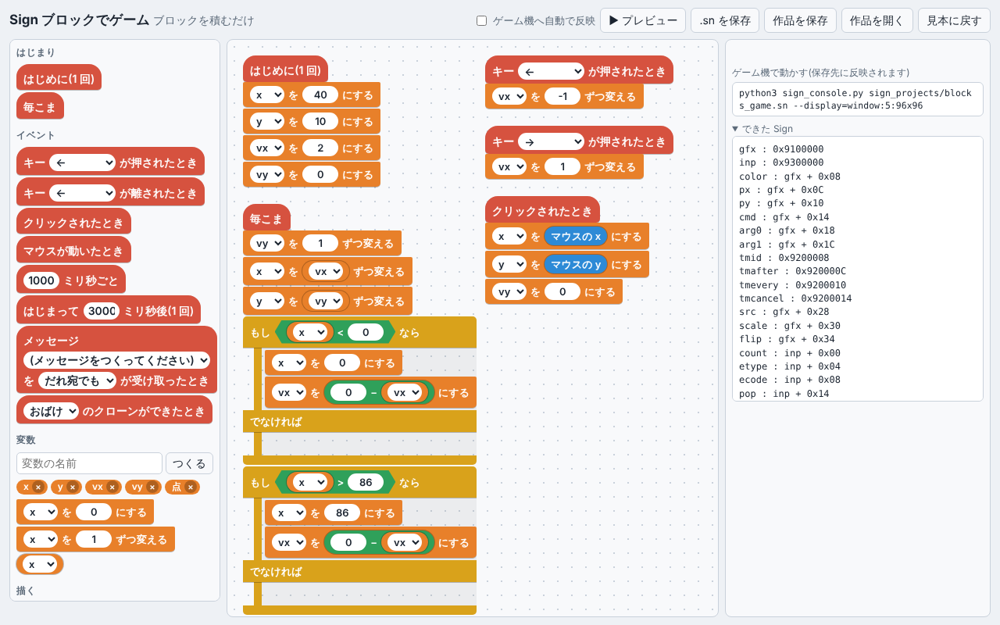
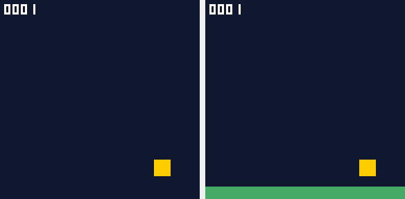
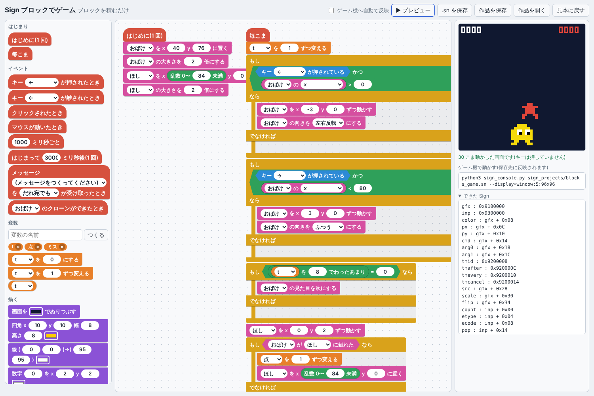
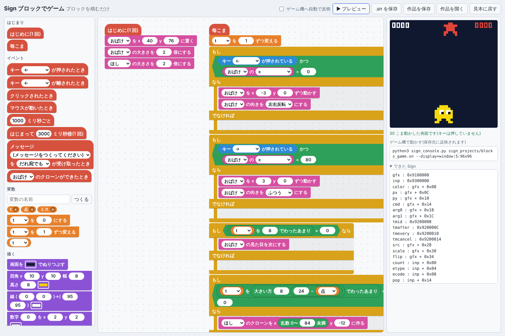
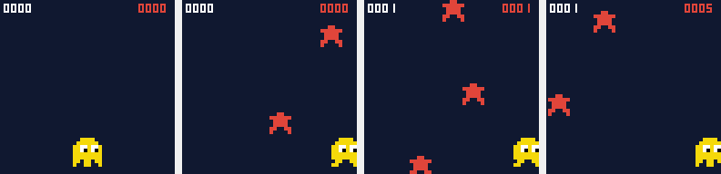

# Sign で作る — ブロックでゲーム

<!-- nav -->
[← 前: Sign で作る — 音・部品・ファイル](04_sound-parts-files.md) | [目次](README.md) | [次: Sign で作る — 標準ライブラリと確かめる道具 →](06_stdlib-and-checks.md)
<!-- /nav -->

Nov 3, 2026 · @たににゃん

**目次**

- はじめに

- 第1章 ブロックで動かす

  - レシピ1 見本のボールを動かす

  - レシピ2 ブロックを足して絵を変える

- 第2章 作品として動かす

  - レシピ3 星を受け止めるゲーム

  - レシピ4 星が降り続けるゲーム

- 付録 操作とコマンドの一覧

## はじめに

この巻は、ブロックを積んでゲームを作るエディタ(sign_scratch.html)のレシピ集です。『描画とゲーム』の続きで、できたゲームは、その巻で使ったゲーム機(sign_console.py)で動かします。単独でも読めますが、ゲーム機の約束(init、tick、on_key など)を知っていると、できた Sign が読みやすくなります。

各レシピは「やりたいこと、操作、実行結果、ひとこと」の順です。この巻のレシピは、コードを書くのではなく、ブロックを積む操作が中心です。エディタは、積んだブロックから Sign のコードを作ってくれるので、その出力を読み、ゲーム機で動かして確かめました。実行は既定のモードで行い、確かめた版は「alpha1 実装 2026-11-06 00:50 JST」です。

コマンドは、bash で打つ形で書いています。確かめたのは Linux の上だけで、Windows や macOS では試していません。

結果の出どころは、入れた印で区別します。

- **【仕様】** 配布された仕様書に書かれている動作です。この巻では、メモリの番地を \# で書き @ で読む動作が、できた Sign の中に出てくる分がこれにあたります。

- **【実装】** sign_interp.py がそう動くだけで、仕様書に見つからない動作です。別の処理系では同じになるとは限りません。

- **【拡張】** 仕様に無い、この実装に添えた道具です。

ブロックのエディタ、エディタが作る Sign、ゲーム機、画面・時計・入力の「窓口」は、すべて【拡張】です。ほかの処理系で同じエディタや同じ番地の装置が使えるとは限りません。

**確かめた範囲** エディタは、人の手ではなく、自動で操作するブラウザ(Chromium)で動かしました。ブロックを棚から落とす、数や色を入れる、作品(JSON)を開く、プレビューを出す、「ゲーム機へ自動で反映」を入れる、といった操作を試し、出てきた絵を目で確かめています。人が手で操作したときの感触や、ほかのブラウザでの見え方、本物の窓でのゲームの操作感は、確かめていません。

印の無い記述は、エディタやゲーム機の動き、動かして見た結果の説明です(すべて【拡張】です)。仕様書との一致を示すのは【仕様】の印だけです。Sign の資料は [johnny-shaman/Sign](https://github.com/johnny-shaman/Sign) にあり、仕様書に無い話は [Discussions](https://github.com/johnny-shaman/Sign/discussions) に出てきます。

## 第1章 ブロックで動かす

### レシピ1 見本のボールを動かす

**やりたいこと** エディタを開いて、最初から入っている見本(跳ねるボール)を動かし、できた Sign をゲーム機でも動かす。

**操作**

1.  エディタを起動します。

```
python3 sign_editor.py
```

窓が自動で開かないときは、--no-open を付けて起動し、ブラウザで http://127.0.0.1:8765/scratch を開きます(番号を変えるときは --port)。

2.  開いた画面です。見本が入っています。



3.  「プレビュー」(▶)を押すと、96×96 の画面で、黄色い四角のボールが落ちて跳ね返ります。

4.  画面の下にある Sign の出力を、ファイル(ここでは ball.sn)に保存して、ゲーム機で動かします。

```
python3 sign_console.py ball.sn --display=png:bc{n}.png:96x96 --timer=virtual --frames=30 --fps=60
```

**実行結果** bc1.png から bc30.png までの 30 枚ができました。30 枚目は、エディタのプレビュー(30 フレーム目)と、画素まで同じでした。

ボールの動きは、できた Sign の tick に出てきます(見本のとき)。

```
tick : z ? (seq10 ((artchk 0) | 0) ((v4 # ((@v4) + 1)) | 0) ((v1 # ((@v1) + (@v3))) | 0) ((v2 # ((@v2) + (@v4))) | 0) ((blk1 0) | 0) ((blk2 0) | 0) ((blk3 0) | 0) ((clear 0x101830) | 0) ((rect (@v1) (@v2) 8 8 0xFFCC00) | 0) (seq3 ((number (ab (@v5)) 2 2 0xFFFFFF) | 0) ((present 0) | 0) (chk 0)))
```

- v1〜v5 は変数ブロックで、番地 0x200000 から 4 ずつ進んだ場所です(v1 が 0x200000、v2 が 0x200004、…)。# で書き、@ で読みます【仕様】。0x200000 から 4 ずつという番地の割り当ては、エディタの決め事です【拡張】。

- 見本では、v1 が横の位置、v2 が縦の位置、v3 が横の速さ、v4 が縦の速さ、v5 が床で跳ねた回数です。

- 毎フレーム、v4 に 1 を足して(落ちる)、位置に速さを足します。blk3 は、縦が 86 を超えたら 86 に戻し、縦の速さを 0.9 倍にして向きを逆にし、回数に 1 を足します。

- 命令の一つ一つが (… \| 0) で包まれ、seq10 seq3 でまとめられています【拡張】。

- 描いたあと、present を呼ぶ行も自動で入ります。ブロックで present を置く必要はありません。

**ひとこと** 「ゲーム機へ自動で反映」を入れると、ブロックを動かすたびに sign_projects/blocks_game.sn が書き換わります。そのファイルを、本物の窓で動かせます。

```
python3 sign_console.py sign_projects/blocks_game.sn --display=window:5:96x96
```

window:5 は 5 倍表示です。

**確かめていないこと** 本物の窓で動かす操作は、この巻では実行していません(画像の書き出しで確かめました)。

### レシピ2 ブロックを足して絵を変える

**やりたいこと** 見本に「緑の地面」を足す。

**操作**

1.  棚から「四角」ブロックを取り、「数字」ブロックの下へ落とします。

2.  四角の欄に、0 90 96 6 を入れ、色を \#44aa66 にします。左から、横の位置、縦の位置、幅、高さです。

3.  プレビューを押します。

**実行結果** 画面の下に緑の帯が出て、ボールは、その帯に当たるあたりで跳ね返ります。



できた Sign で変わったのは、tick の最後の部分だけでした。

```
(seq3 ((number (ab (@v5)) 2 2 0xFFFFFF) | 0) ((present 0) | 0) (chk 0))
```

が、次のようになりました。

```
(seq4 ((number (ab (@v5)) 2 2 0xFFFFFF) | 0) ((rect 0 90 96 6 0x44AA66) | 0) ((present 0) | 0) (chk 0))
```

seq3 が seq4 になり、(rect 0 90 96 6 0x44AA66) が一つ増えています。ブロックを一つ足すと、tick の中の命令が一つ増える、と読めます。

**ひとこと** 四角は、ボールを描いたあとに描かれます。そのため、ボールが床で跳ねるとき(縦が 86 のとき、ボールの下端は 94)は、緑の帯がボールの下側に重なります。順番を変えたいときは、ブロックをボールの前へ動かしてください。

**確かめていないこと** ブロックの順番を入れ替えた絵は、確かめていません。

## 第2章 作品として動かす

この章では、できあがったゲームの作品ファイル(JSON)をエディタで開き、中のブロックを読み、ゲーム機で動かします。

### レシピ3 星を受け止めるゲーム

**やりたいこと** 落ちてくる星を、おばけで受け止める。受け止めたら点、落としたらミス。ミスが 5 になったら止まる。

**操作**

1.  エディタの「作品を開く」で star_catch.json を選びます。

2.  積まれたブロックを読みます。



- 開始時(init)に、おばけを (40, 76)、ほしを横はランダム・縦 0 に置き、どちらも 2 倍にします。

- 毎フレーム(tick)、t に 1 を足します。左キーを押していて、おばけの横が 0 より大きければ左へ 3、右キーを押していて 80 より小さければ右へ 3 動かし、向きも変えます。

- t を 8 で割った余りが 0 のとき、おばけの絵を次の絵に替えます(足が動いて見えます)。

- ほしを縦に 2 動かします。おばけに触れたら「点」に 1 を足してほしを上に戻し、縦が 96 を超えたら「ミス」に 1 を足してほしを上に戻します。

- 「点」と「ミス」を画面に出し、ミスが 5 以上なら止めます。

3.  作品のブロックから作った Sign をファイルに保存して(ここでは star_catch_ui.sn)、ゲーム機で動かします。右キーを 500 ミリ秒のとき、左キーを 2000 ミリ秒のときに押す入力を付けました。

```
python3 sign_console.py star_catch_ui.sn --display=png:gc{n}.png:96x96 --timer=virtual --frames=900 --fps=60 --input=500:kd:29,2000:kd:28
```

29 が右キー、28 が左キーの番号です。

**実行結果** 900 枚を頼んだところ、311 枚で終わりました。ミスが 5 になって止まったためです。同じ作品として配られている star_catch.sn を同じ条件で動かした絵と比べると、240 枚目と 311 枚目は、ファイルの内容(md5)が同じでした。

できた Sign と配られた star_catch.sn の違いは、コメントの行と、時計やメッセージの番地を決める行が増えている点だけでした(今のエディタで配られた作品のファイルを開いて作った Sign を、配られた star_catch.sn と行ごとに比べた結果です)。

**ひとこと** キーは押したままの間だけ効く作りです。入力の指定は「押した」だけで「離した」を書いていないので、このレシピでは、押した後ずっと押しっぱなしになります。

**確かめていないこと** 人の手でキーを押したときのおばけの動かしやすさは、確かめていません。

### レシピ4 星が降り続けるゲーム

**やりたいこと** 星を一つずつではなく、次々に降らせる。点が増えるほど、降る間隔を短くする。

**操作**

1.  「作品を開く」で star_rain.json を選びます。



2.  レシピ3との違いを読みます。

- ほしは 1 つではなく、「クローン」を作って増やします。t を「8 と、24 から点を引いた数の大きいほう」で割った余りが 0 のとき、横はランダム・縦 -12 の位置に 1 つ作ります。点が 16 になるまで間隔が 24 から 8 へ縮まり、それ以降は 8 のままです。

- 「ほしのクローンそれぞれについて」のブロックの中で、縦に 2 動かして描き、おばけに触れたら点に 1 を足してそのクローンを消し、縦が 96 を超えたらミスに 1 を足して消します。

- おばけの動き、点とミスの表示、ミスが 5 で止まる点は、レシピ3と同じです。

3.  動かします。

```
python3 sign_console.py star_rain_ui.sn --display=png:sr{n}.png:96x96 --timer=virtual --frames=600 --fps=60 --input=300:kd:29,1500:kd:28
```

**実行結果** 192 枚で終わりました。配られた star_rain.sn を同じ条件で動かした絵と比べると、100 枚目と 192 枚目は同じでした。1・60・120・192 枚目の画面に出た「点 / ミス」は、次のとおりでした。

| 枚目 | 点  | ミス |
|------|-----|------|
| 1    | 0   | 0    |
| 60   | 0   | 0    |
| 120  | 1   | 1    |
| 192  | 1   | 5    |



**ひとこと** 入力が 2 回だけなので、おばけは星をほとんど受け止められず、5 回落として終わりました。受け止めるには、キーの入力を増やしてください。

**確かめていないこと** 点がたくさん入ったときの降る間隔の変化は、画面では確かめていません(上の読み方は、ブロックの中身から読んだものです)。

## 付録 操作とコマンドの一覧

### エディタ

| やりたいこと         | 操作                                                                       |
|----------------------|----------------------------------------------------------------------------|
| 起動する             | python3 sign_editor.py(窓を開かないなら --no-open、番号は --port N)        |
| 開くページ           | http://127.0.0.1:8765/scratch                                              |
| 動きを見る           | プレビュー(30 フレーム分)                                                  |
| 作品を開く           | 「作品を開く」で JSON を選ぶ                                               |
| ゲーム機へ自動で反映 | 入れると、ブロックを動かすたびに sign_projects/blocks_game.sn が書き換わる |

### ゲーム機

| やりたいこと           | コマンド                                                                                         |
|------------------------|--------------------------------------------------------------------------------------------------|
| 絵をファイルに書き出す | python3 sign_console.py game.sn --display=png:f{n}.png:96x96 --timer=virtual --frames=N --fps=60 |
| 本物の窓で動かす       | python3 sign_console.py game.sn --display=window:5:96x96                                         |
| キーを押す入力を付ける | --input=500:kd:29(ミリ秒:押す(kd)か離す(ku):キー番号。29 が右、28 が左)                          |

### できた Sign のところを読む目印

| 見つけたもの | 意味                                         |
|--------------|----------------------------------------------|
| v1、v2…      | 変数ブロック。番地 0x200000 から 4 ずつ      |
| tick         | 毎フレームのブロックが入るところ             |
| init         | 開始時のブロックが入るところ                 |
| on_key       | キーを押したときのブロックが入るところ       |
| (… \| 0)     | 命令を包む形。エディタが自動で付ける【拡張】 |
| seqN         | N 個の命令を順に実行する【拡張】             |

この巻の結果は、すべて既定のモードで確かめました。

---

<!-- nav -->
[← 前: Sign で作る — 音・部品・ファイル](04_sound-parts-files.md) | [目次](README.md) | [次: Sign で作る — 標準ライブラリと確かめる道具 →](06_stdlib-and-checks.md)
<!-- /nav -->
