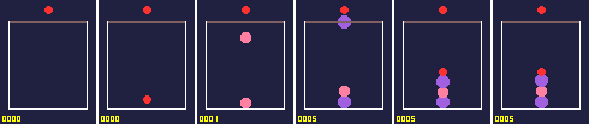
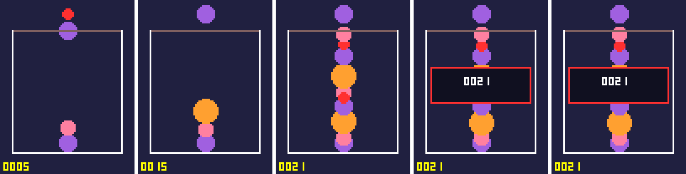
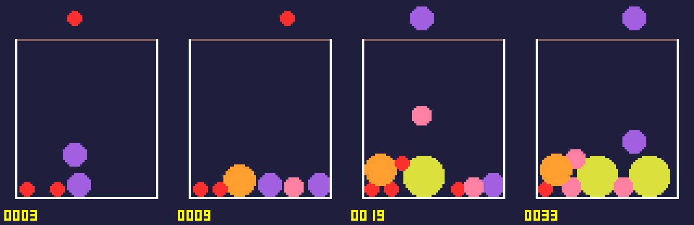
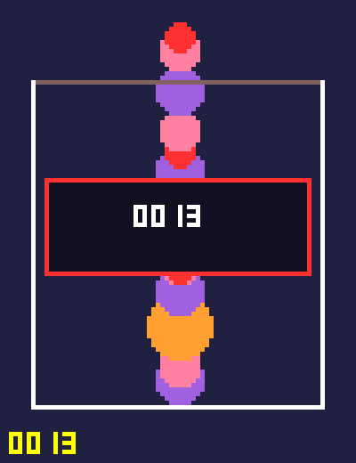

# Sign で作る — 大きなゲームを読む

<!-- nav -->
[← 前: Sign で作る — 標準ライブラリと確かめる道具](06_stdlib-and-checks.md) | [目次](README.md) | [次: Sign で作る — 仕様と実装の違い →](08_spec-vs-impl.md)
<!-- /nav -->

Nov 3, 2026 · @たににゃん

### 目次

- 第1章 動かして見る — レシピ1 台本の入力で動かす、レシピ2 ゲームオーバーまで落とし続ける
- 第2章 部品に分けて読む — レシピ3 状態がどこにあるか調べる、レシピ4 カーソルの動く範囲と果物の落ち方、レシピ5 果物の種類と円の絵、レシピ6 数字の表示とキー入力
- 第3章 ルールを読む — レシピ7 落とす(待ち時間と次の果物)、レシピ8 落ちる・ぶつかる、レシピ9 合体と得点、レシピ10 ゲームオーバー
- 付録 早見表

## はじめに

この巻は、配布物のいちばん大きなプログラム `suika.sn`(614 行の「スイカゲーム」)を、部品に分けて読むレシピ集です。一つひとつを、動かして確かめながら読みます。[第3巻](03_draw-and-game.md)『描画とゲーム』を読んでいると、画面やキー入力の「窓口」の話がすんなり入ってきます。

このプログラムは、ゲーム機の約束(`init`、`tick`)ではなく、自分でくり返しの輪を回して、画面・時計・入力の窓口を直接使う形で書かれています。そのため、`python3 sign_interp.py` で直接動かします。

各レシピは「やりたいこと、操作、実行結果、ひとこと」の順です。実行は既定のモードで行い、確かめた版は「alpha1 実装 2026-11-06 00:50 JST」です。

コマンドは、bash で打つ形で書いています。確かめたのは Linux の上だけで、Windows や macOS では試していません。

結果の出どころは、入れた印で区別します。

- **【仕様】** 配布された仕様書に書かれている動作です。この巻では、番地を `#` で書き `@` で読む動作がこれにあたります。
- **【実装】** `sign_interp.py` がそう動くだけで、仕様書に見つからない動作です。別の処理系では同じになるとは限りません。
- **【拡張】** 仕様に無い、この実装に添えた道具です。

画面、時計、入力の「窓口」、`--display` や `--timer`、`--input` の指定は、すべて【拡張】です。ゲームのルール(どのように落とすか、どう合体するか)は、このプログラムを書いた人の設計です。そのため、ゲームのルールを調べた結果には、印を付けていません。

**確かめた範囲** 1台のパソコンの中で、窓を開かずに、画面を画像として書き出し、キーを台本(時刻つきの入力)で流し込んで確かめました。時計は、実際の時間ではなく仮想の時計(`--timer=virtual`)です。本物の窓で人が遊ぶときの感触や速さは、確かめていません。

印の無い記述は、ゲームのルール、動かして見た結果の説明です。仕様書との一致を示すのは【仕様】の印だけです。Sign の資料は [johnny-shaman/Sign](https://github.com/johnny-shaman/Sign) にあり、仕様書に無い話は [Discussions](https://github.com/johnny-shaman/Sign/discussions) に出てきます。

## 第1章 動かして見る

読む前に、まず動かして、何が起きるゲームかを見ます。`suika.sn` の先頭のコメントに、遊び方がこう書かれています。「矢印の左右で位置を決め、スペースで落とす。同じ果物が触れると 1 つ大きくなる。q か 閉じる で終わる」。

### レシピ1 台本の入力で動かす

**やりたいこと** 窓を開かずに、スペースを 7 回押したときの画面を、画像で見る。

**操作**

```
python3 sign_interp.py suika.sn --display=png:f{n}.png:80x104 --timer=virtual --input=200:kd:32,900:kd:32,1600:kd:32,2300:kd:32,3000:kd:32,3700:kd:32,4400:kd:32,7400:kd:113
```

- `--display=png:f{n}.png:80x104` は、画面を 80×104 の画像として `f1.png`、`f2.png`…と書き出します。
- `--timer=virtual` は、実際に待たずに、時計を仮想で進めます。
- `--input=ミリ秒:kd:キー番号` は、その時刻にキーを押すという台本です(`kd` が押す、`ku` が離す)。`32` がスペース、`113` が `q` です。

**実行結果** 画像が 209 枚でき、最後に `5` が一つ出ました。これは得点です。下の図は、画像の 1・20・50・100・150・209 枚目です(3 倍に拡大)。



画面の上は「次に落とす果物」、白い枠が落とす箱、左下の黄色い数字が得点です。同じ色の果物が触れると、合体して一つ大きい果物になります(1 枚目の赤い果物が、後の枚では、赤同士が合体してピンク、ピンク同士で紫になっています)。

**ひとこと** 枚数は時間の長さではなく、絵を書き換えた回数です。仮想の時計を使うと、同じ台本からは、いつでも同じ枚数、同じ絵、同じ得点が出ます【拡張】(仮想の時計は --timer=virtual という道具の働きで、台本の入力が同じなら結果が同じになるのは、この道具とゲームの作りの両方によります)。「実行の最後に得点が出る」のは、くり返しの輪が終わるときに得点を返す作りになっていて、トップレベルの最後の式の値が画面に出ます【実装】。

**確かめていないこと** 最後の画像に至るまでに、果物がどのような順で触れ合って合体したか(途中の全部の画像)は、すべては見ていません。上の 6 枚だけです。

### レシピ2 ゲームオーバーまで落とし続ける

**やりたいこと** 果物を同じ場所に落とし続けて、終わりの画面を見る。落とせなくなることも確かめる。

**操作** スペースを 780 ミリ秒ごとに押す台本を作り、落とす回数を変えて試します。カーソルは動かさず、中心(横 40)のままです。次のコードは Sign ではなく、台本の文字列を組み立てる bash(シェル)のスクリプトです。手で書いても同じ結果になります。最後の行は、Sign のプログラムを動かすコマンドです。

```
N=17
inp=""
for i in $(seq 0 $((N-1))); do
  t=$((160 + 780*i))
  inp="$inp$t:kd:32,$((t+10)):ku:32,"
done
inp="${inp}$((160 + 780*(N-1) + 3000)):kd:113"

python3 sign_interp.py suika.sn --display=png:h{n}.png:80x104 --timer=virtual --input=$inp
```

**実行結果**

| 落とした回数 | 終わりに出た得点 | 画像の枚数 | ゲームオーバー |
| --- | --- | --- | --- |
| 16 以下 | — | — | なし(15、16 で確かめました) |
| 17 | 21 | 389 | あり |
| 30 | 21 | 389 | あり |

終わりの画面は次のとおりでした(画像の 100、199、388、389 枚目。389 枚目は最後の枚で、それより前のどの枚とも同じではありません)。枚数は 2026-11-08 に取り直した値で、17 回でも 30 回でも 389 枚、得点 21、ゲームオーバーありでした。



果物が線より上に出ている状態が続くと、真ん中に赤い枠のバナーと得点が出て、ゲームオーバーになりました。このときの得点は 21 でした。

**ひとこと** 17 回でゲームオーバーになり、30 回でも得点と画像の枚数が同じでした。終わったあとは、スペースを押しても果物は落とせず、バナーの画面で止まります。この台本は、果物の次の段が乱数で決まるゲームの一つの場面です。別の落とし方では、結果は変わります。

**確かめていないこと** `閉じる`(窓を閉じる出来事)で終わる動きは、窓を開かないこの条件では確かめていません。

## 第2章 部品に分けて読む

大きなプログラムは、部品ごとに読むと追えます。この章では、状態の置き場、カーソルと落ち方、果物の種類と円の絵、数字の表示とキー入力の4つを見ます。

### レシピ3 状態がどこにあるか調べる

**やりたいこと** 変数のないこの言語で、ゲームの状態がどこに入っているかを知りたい。

**操作** プログラムの最後の行 `loop FRAMES (drain 0)` を、終了時に1つの値を表示する形に書き換えて動かします。書き換えは `seq2 (loop FRAMES (drain 0)) (gs N)` で、`N` が見たい番地(状態配列 G の先頭からの位置)です。`--input` でキー操作を渡し、最後に `q` を押して終わらせます。

次のシェルスクリプト(bash)に、この書き換えを包みます。`peek.sh` として保存し、`chmod +x peek.sh` で実行できるようにします。1 つ目の引数が終わりに表示する式、2 つ目が台本です。元の `suika.sn` は変わりません。

```
#!/bin/bash
sed '$d' suika.sn > peek.sn
echo "seq2 (loop FRAMES (drain 0)) ($1)" >> peek.sn
python3 sign_interp.py peek.sn --display=null --timer=virtual --input="$2"
```

`sed '$d'` は、最後の行を除いて写します。`--display=null` は、画面を出さない指定です。最初のカーソルの x(`G+4`)は、次のとおりです。

```
./peek.sh 'gs 4' 500:kd:113
```

`40` と出ました。`500:kd:113` は、500 ミリ秒に q を押して終わらせる台本です。以降のレシピでも、この `peek.sh` を使います。

**実行結果** suika.sn の状態は、0x3000 から始まる配列 G にまとまっています。調べて分かった主な位置は次のとおりです。

| G+ | 中身 | 確かめた値 |
| --- | --- | --- |
| 4 | カーソルの x | 最初は 40 |
| 8 | 落とした後の待ち時間 | 落とすと 20 になり、1 こまごとに 1 ずつ減る |
| 12 | 次に出る果物の段 | 最初は 0 |
| 16 | 乱数の種 | 最初は 7 |
| 24 | ゲームオーバーの旗 | 終わると 1 |
| 32 | 果物の数 | 落とすと増え、合体すると減る |

果物そのものは別の場所(0x100000 から)にあり、1個につき8つの数 `[段 x y vx vy 押付 半径 重さ]` が並びます。位置と速さは 1/16 ピクセル単位です。

**ひとこと** 変数が使えなくても、番地に名前を付けて覚えれば、状態の表が作れます。プログラムを読む前に、この表を先に作っておくと追いやすくなります。

**気をつける点** 最後の行を書き換えるのは調べるためだけです。元の suika.sn は変えずに、コピーで試してください。

### レシピ4 カーソルの動く範囲と果物の落ち方

**やりたいこと** 左右キーでどこまで動けるか、落とした果物がどう動くかを数字で確かめたい。

**操作** 左キー(28)や右キー(29)を何度も押すように入力を作り、終了時の G+4 を見ます。果物は、落とした直後と着地後に、果物のリストの先頭の記録を見ます。

左キー(28)を 30 回押す台本は、次のように作ります(20 ミリ秒ごとに押して離します)。右キー(29)を 40 回押すなら、`seq 0 29` を `seq 0 39` に、`kd:28` と `ku:28` を `kd:29` と `ku:29` に変えます。

```
inp=""
for i in $(seq 0 29); do
  t=$((100 + 20*i))
  inp="$inp$t:kd:28,$((t+10)):ku:28,"
done
./peek.sh 'gs 4' "${inp}2000:kd:113"
```

左を 1 回だけ押すなら、次のとおりです。

```
./peek.sh 'gs 4' 100:kd:28,110:ku:28,500:kd:113
```

果物の記録は、リストの先頭の果物を `cell 0` で読みます。200 ミリ秒にスペースで落とし、約 190 ミリ秒(12 コマ)あとに終えた場合と、十分あとに終えた場合です。

```
./peek.sh 'cell 0' 200:kd:32,210:ku:32,392:kd:113
./peek.sh 'cell 0' 200:kd:32,210:ku:32,2000:kd:113
```

**実行結果** カーソルは1回で3ずつ動きます。左を30回押すと 14、右を40回押すと 66 で止まりました(壁の位置 LEFT 8・RIGHT 72 から 6 だけ内側です。コードで LEFT + 6、RIGHT - 6 と決めているためです)。左を1回押すと 37 でした。

落とした果物の記録は、落としてから約 190 ミリ秒(12 コマ)後に止めると `[0, 640, 692, 0, 72, 0, 48, 9]`、着地後は `[0, 640, 1392, 0, 0, 1, 48, 9]` でした。落ちている間は縦の速さ vy が 1コマごとに 6 ずつ増えます(12コマで 72)。着地すると y は 1392(床 FLOOR 90 の 16 倍から半径 48 を引いた値)になり、速さは 0、押付は 1 になります。

**ひとこと** 1/16 ピクセルで持つと、整数だけでなめらかな落下が作れます。

### レシピ5 果物の種類と円の絵

**やりたいこと** 果物の大きさと色、円の描き方を知りたい。

**操作** `radius` と `col` の値を、段 0〜5 について表示します。円は丸い図形を命令で描くのではなく、横一列の「帯」の集まりとして持っています。

表示には、レシピ3 の `peek.sh` を使います。色は 10 進で出ます。`get RUNS` が段 0 の円の帯です。

```
./peek.sh '[(radius 0) (radius 1) (radius 2) (radius 3) (radius 4) (radius 5)]' 100:kd:113
./peek.sh '[(col 0) (col 1) (col 2) (col 3) (col 4) (col 5)]' 100:kd:113
./peek.sh 'get RUNS' 100:kd:113
```

**実行結果** 半径は段 0〜5 で 3, 4, 5, 7, 9, 11 ピクセル、色は、画面には 10 進で 16724016、16744608、10510560、16752688、14213184、3194960 と出ます。16 進に直すと FF3030、FF80A0、A060E0、FFA030、D8E040、30C050 です。段 0 の円の帯は、3つ組 (縦の位置, 高さ, 半分の幅) を並べた次の数列になりました。

`[-3, 1, 1, -2, 1, 2, -1, 3, 3, 2, 1, 2, 3, 1, 1]`

中心から見て、上から1行ずつ幅が 1, 2, 3 と広がり、下で戻る形です。

**ひとこと** 小さな画面では、円を数列として持つと、描く処理が単純になります。

**確かめていないこと** 段 1〜5 の帯の数列は並べていません。

### レシピ6 数字の表示とキー入力

**やりたいこと** 得点の数字の描き方と、キー入力の受け取り方を知りたい。

**操作** 7セグメント表示の関数 (`mask` `seg` `digit` `number`) の名前をたどります。実行すると、得点が 0000, 0001, 0005, 0015, 0021 と映った画面が得られます。入力の受け取りは `drain` と `key` にあり、`drain` は出来事の種類で分けます。

レシピ2 と同じ台本の作り方で、落とす回数 `N` だけを変え、`suika.sn` をそのまま動かして、終わりに出る得点を見ます。

```
for N in 0 2 5 9 14; do
  inp=""
  for i in $(seq 0 $((N-1))); do
    t=$((160 + 780*i))
    inp="$inp$t:kd:32,$((t+10)):ku:32,"
  done
  inp="${inp}$((160 + 780*(N>0 ? N-1 : 0) + 3000)):kd:113"
  echo -n "落とした回数 $N: "
  python3 sign_interp.py suika.sn --display=null --timer=virtual --input="$inp" | tail -1
done
```

得点は、順に 0、1、5、15、21 と出ました。`--display=null` を `--display=png:f{n}.png:80x104` に変えれば、同じ得点が左下に 7 セグメントの数字で出ます(`N=14` の最後の画像は 0021 でした。落とした回数 0、2、5、9 の最後の画像も見て、左下の数字が 0000、0001、0005、0015 で、上の得点と合うことを確かめました。1 の字は細く、0001 は 000 のあとに細い 1 が並ぶ形です)。

**実行結果** `drain` は、種類 6(ウィンドウを閉じる)、種類 1 でコード 113(q)、そのほかは `key` に渡します。1回の `loop` ごとに `tick` を呼び、`sleep # 16` で待ちます。この言語の標準の `init`/`tick` の形は使わず、自分で出来事の繰り返しを持っています。

**ひとこと** 数字は線の部品の組み合わせで作れるので、画像や文字の機能がなくても得点が出せます。

**確かめていないこと** 種類 6(ウィンドウを閉じる)の出来事は、実際のウィンドウがないため動かしていません。

## 第3章 ルールを読む

ここからは、遊びのルールがどこでどう決まっているかを、数字で確かめます。

### レシピ7 落とす(待ち時間と次の果物)

**やりたいこと** 果物を落とす間隔の決まりと、次に出る果物の決まり方を知りたい。

**操作** スペースキー(32)を、間隔を変えて2回押す入力を作り、終了時の果物の数 G+32 を見ます。次に、1回ずつ落として G+12 を見ます。

2 回押す間隔 `d` を変えて、終わりの果物の数を読みます(2 回目を押した約 100 ミリ秒後に終えます)。

```
for d in 100 200 300 350 400 500; do
  echo -n "間隔 $d: "
  ./peek.sh 'gs 32' "200:kd:32,210:ku:32,$((200+d)):kd:32,$((210+d)):ku:32,$((210+d+100)):kd:113"
done
```

次に、落とした回数 `n` を 0 から 7 まで変えて、次に出る果物の段 `G+12` を読みます(1 秒おきに落とします)。

```
for n in 0 1 2 3 4 5 6 7; do
  inp=""
  for i in $(seq 1 $n); do
    t=$((160 + 1000*(i-1)))
    inp="$inp$t:kd:32,$((t+10)):ku:32,"
  done
  echo -n "$n 回落としたあと: "
  ./peek.sh 'gs 12' "${inp}$((160 + 1000*n + 2000)):kd:113"
done
```

**実行結果** 落とすと待ち時間 G+8 が 20 コマになり、その間の落下は受け付けません。2回の間隔が 100、200、300 ミリ秒のときは果物の数が 1 で、350、400、500 ミリ秒のときは 2 でした(2 回目を押してから約 100 ミリ秒後に終えたときの数です。同じ x に落ちた果物は着地したときに合体するため、もっとあとに終えると数は 1 に減ります。1 回目と 2 回目が同じ段の果物のときです)。

次に出る果物の段は、乱数の種 G+16 から決まります。種は最初 7 で、落とすたびに `(種 * 25 + 7) % 64` に変わり、その値を 3 で割った余りが次の段になります。0 回から 7 回落としたあとの G+12 は、順に 0, 0, 1, 0, 0, 2, 0, 0 でした。k 個目に落ちる果物の段は 0, 0, 1, 0, 0, 2, 0, 0, 1, 2 の順です。

**ひとこと** 乱数と言っても決まった式なので、同じ入力なら毎回同じ果物が出ます。確かめるのに向いています。

### レシピ8 落ちる・ぶつかる

**やりたいこと** 重力と衝突が、何コマでどう進むかを知りたい。

**操作** 物理の部分は、1つの果物に対して「速さを足す → 押し戻す → 壁と床に当てる」を最大 PASSES 回(4回)くり返します。重なりが残らなければ途中で止まります。定数は GRAV 6、VMAX 96、SLEEP 6、NEAR 32 です。

定数は、`grep` で調べます(これも bash のコマンドです)。

```
grep -nE '^(GRAV|VMAX|PASSES|SLEEP|NEAR) :' suika.sn
```

出力は、`228:GRAV : 6`、`229:VMAX : 96`、`230:PASSES : 4`、`240:SLEEP : 6`、`242:NEAR : 32` の 5 行でした(行番号は、確かめた版のファイルのものです)。

**実行結果** レシピ4で見たとおり、落下中は vy が 1 コマごとに 6 ずつ増え、着地すると y が床の高さに合って押付が 1 になります。同じ果物どうしが近づくと合体の判定に進み、違う段どうしなら押し戻します。

**ひとこと** 重なったら離す、という素朴な処理を何度か繰り返すだけで、積み上がる動きになります。

**確かめていないこと** 押し戻しの細かい式(果物の重さの比率の使い方)は、数字では追っていません。また、速さの上限 VMAX や SLEEP の効き方は、別の入力で試していません。

### レシピ9 合体と得点

**やりたいこと** 同じ段の果物がぶつかったとき何が起こるか、得点がどう増えるかを知りたい。

**操作** 得点を求める関数 `tri` に 1 から 6 を渡して結果を見ます。

レシピ3 の `peek.sh` で、最後に `tri 1` から `tri 6` を並べて表示します。

```
./peek.sh '[(tri 1) (tri 2) (tri 3) (tri 4) (tri 5) (tri 6)]' 100:kd:113
```

**実行結果** `tri n` は `(n*(n+1))/2` で、三角数を返します。1 から 5 までの合体の得点は 1, 3, 6, 10, 15 です。最大の段の果物が2つ合わさると、2つとも消えて 21 点になります。実行して確かめた並びは `[1, 3, 6, 10, 15, 21]` でした。

合体では、段が1つ上の果物が、2つの中間の位置にできます(`merge`)。最大の段どうしのときは、新しい果物は作らず、2つとも取り除きます(`vanish`)。合体するか、消えるか、押し戻すかの分かれ目は `chk` にあります。

**ひとこと** 点数が三角数なので、大きな段ほど急に値が上がります。

**配布されている画像** 資料と一緒に配られている `suika_frames.png` は、合体が進んで得点が増えていく様子を 4 枚の画面で並べた図です。得点は左から 0003、0009、0019、0033 と出ています。この画像を作った入力の台本は分からず、この本では同じ画像を作り直していません。そのため、ここでは図の見た目を述べるだけで、レシピ2 のような手順での確認はしていません。



### レシピ10 ゲームオーバー

**やりたいこと** 終わりの条件を確かめたい。

**操作** 17個以上落とす入力で、最後まで遊んでみます。

レシピ2 の台本の作り方で、落とした回数 16 と 17 を比べます。表示するのは、旗 `G+24`、線より上に出ているこま数 `G+20`、得点です。

```
for N in 16 17; do
  inp=""
  for i in $(seq 0 $((N-1))); do
    t=$((160 + 780*i))
    inp="$inp$t:kd:32,$((t+10)):ku:32,"
  done
  inp="${inp}$((160 + 780*(N-1) + 3000)):kd:113"
  echo -n "落とした回数 $N: "
  ./peek.sh '[(gs 24) (gs 20) (gs 0)]' "$inp"
done
```

**実行結果** 果物の上の端 `y - r` が天井(TOP の 18 に 16 を掛けた値)より上に出た状態が、連続して HOLD の 45 コマ続くと、ゲームオーバーになります(`above` と `judgev`)。そうなると赤い枠の中に得点が出ます(`banner`)。G+24 が 1 になり、その後の落とす操作は無視されます。

上のコマンドの出力は、16 回が `[0, 0, 21]`、17 回が `[1, 45, 21]` でした。17 回で旗(`G+24`)が 1 になり、線より上に出ていたこま数(`G+20`)が `HOLD` の 45 に届いています。

**ひとこと** 「すぐに負けにしない」ための待ちが、45 コマという数字で入っています。ゲームの手触りは、こういう数字で作られています。

**配布されている画像** `suika_gameover.png` は、ゲームオーバーの画面の例で、箱の真ん中に赤い枠のバナーが出て得点 0013 が表示されています。これもレシピ2 の画像とは別のもので、作った台本は分かりません。バナーの形を見比べる参考として載せます。



**確かめていないこと** 早道(`fast` `full` `core` `play` `quiet`)の部品は、描き直しを減らすためのものです。このファイル自身のコメントにはそう書かれていますが、中身は別に確かめていません。

## 付録 早見表

### 実行するコマンド

| やりたいこと | コマンド |
| --- | --- |
| 画像に保存して遊ぶ | `python3 sign_interp.py suika.sn --display=png:f{n}.png:80x104 --timer=virtual --input=...` |
| キー操作を渡す | `--input=時刻(ms):kd:キー,...`(スペース 32、左 28、右 29、q 113) |
| 定めている約束を確かめる | `python3 sign_interp.py --check suika.sn` |

状態を調べるときは、レシピ3 の `peek.sh`(bash)を使います。1 つ目の引数が終わりに表示する式、2 つ目が `--input` の台本です。例として、カーソルの x は次のとおりです(`40` と出ます)。

```
./peek.sh 'gs 4' 500:kd:113
```

【拡張】suika.sn は、初めの確認で `--check` の断り 0・注意 3 でした。`--strict` で実行しても、得点は 21 で同じでした(値を取り出して比べた結果です。2026-11-04 22:40 の版から --strict は、value\_spec.md の V9【仕様】に合わせて最後の行の値を画面に出さないので【実装】、画面では見えません)。また、--strict で走らせると、仮引数 px と py がファイルの定義を隠すという知らせ(name-shadow)が 2 件出ます(【仕様】R133。断りではありません。【実装】走らせて確かめました。結果は変わりません)。

### 状態配列 G (0x3000 から)

| G+ | 中身 |
| --- | --- |
| 4 | カーソルの x |
| 8 | 落とした後の待ち時間 |
| 12 | 次の果物の段 |
| 16 | 乱数の種 |
| 24 | ゲームオーバーの旗 |
| 32 | 果物の数 |

### 部品と関数名

| 部品 | 関数名 | 読んだ章 |
| --- | --- | --- |
| 果物の大きさ・色・円の帯 | `radius` `col` | レシピ5 |
| 数字の表示 | `mask` `seg` `digit` `number` | レシピ6 |
| 出来事の受け取り | `drain` `key` `loop` | レシピ6 |
| 合体・得点 | `chk` `merge` `vanish` `tri` | レシピ9 |
| ゲームオーバー | `above` `judgev` `banner` | レシピ10 |
| 描き直しを減らす早道 | `fast` `full` `core` `play` `quiet` | レシピ10(確かめていません) |

### この本で確かめていないことのまとめ

- ウィンドウを閉じる出来事(種類 6)
- 早道の中身
- 実際のウィンドウでの見え方と操作感
- 押し戻しの細かい式、段 1〜5 の円の帯

---

<!-- nav -->
[← 前: Sign で作る — 標準ライブラリと確かめる道具](06_stdlib-and-checks.md) | [目次](README.md) | [次: Sign で作る — 仕様と実装の違い →](08_spec-vs-impl.md)
<!-- /nav -->
