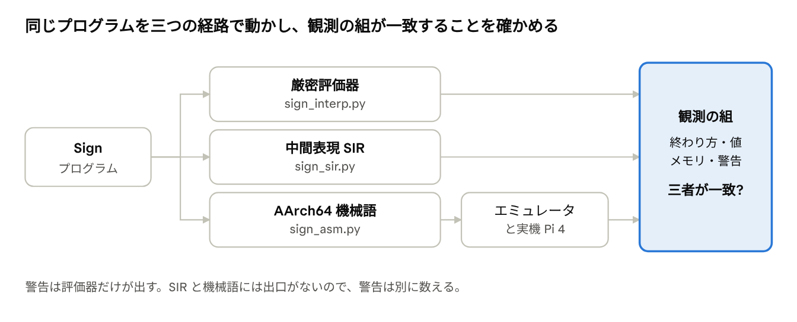
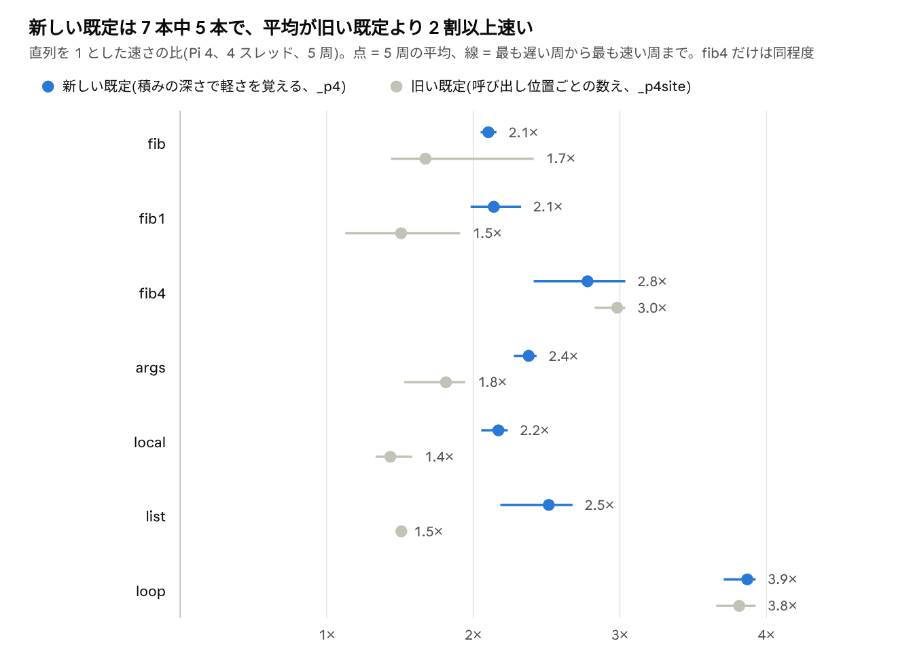

# 最適化の本 — Sign を題材に、インタープリタとコンパイラの最適化を解く(目次と各章の要約)

> この文書は目次と各章の要約です。各章の本文は Claude Docs で書いたものを Markdown にして、順に置いています(下の表)。

## 本文

| 章 | ファイル |
|---|---|
| はじめに | [00_introduction.md](00_introduction.md) |
| 第1章 Sign という言語 | [01_sign-language.md](01_sign-language.md) |
| 第2章 三つの実行経路 | [02_three-routes.md](02_three-routes.md) |
| 第3章 観測とは何か | [03_observation.md](03_observation.md) |
| 第4章 何を測るか | [04_what-to-measure.md](04_what-to-measure.md) |
| 第5章 測定の落とし穴 | [05_measurement-pitfalls.md](05_measurement-pitfalls.md) |
| 第6章 プロファイルと仮説 | [06_profile-and-hypothesis.md](06_profile-and-hypothesis.md) |
| 第7章 速い道 run\_pure | [07_fast-path-run-pure.md](07_fast-path-run-pure.md) |
| 第8章 副作用の判定 | [08_effect-analysis.md](08_effect-analysis.md) |
| 第9章 末尾呼び出しを評価器で | [09_tail-calls-evaluator.md](09_tail-calls-evaluator.md) |
| 第10章 純粋関数の答えを記憶する | [10_memoize-pure.md](10_memoize-pure.md) |
| 第11章 なぜ中間表現を置くか | [11_why-ir.md](11_why-ir.md) |
| 第12章 書き換えの正しさ | [12_rewrite-correctness.md](12_rewrite-correctness.md) |
| 第13章 `--strict --asm` のための木の書き換え | [13_cases-rewrite.md](13_cases-rewrite.md) |
| 第14章 デッドコードの除去 | [14_dead-code.md](14_dead-code.md) |
| 第15章 末尾呼び出しを機械語へ | [15_tail-calls-machine-code.md](15_tail-calls-machine-code.md) |
| 第16章 整数溢れ検査と最適化 | [16_overflow-checks.md](16_overflow-checks.md) |
| 第17章 ピープホール最適化 | [17_peephole.md](17_peephole.md) |
| 第18章 器の配置と特殊化 | [18_container-placement.md](18_container-placement.md) |
| 第19章 共通部分式と不変量の持ち上げ | [19_cse-hoisting.md](19_cse-hoisting.md) |
| 第20章 式の独立性を見つける | [20_independence.md](20_independence.md) |
| 第21章 --par=N スレッドプール | [21_par-thread-pool.md](21_par-thread-pool.md) |
| 第22章 投機実行と巡り戻し | [22_speculation-rewind.md](22_speculation-rewind.md) |
| 第23章 軽い仕事をどう扱うか | [23_light-work.md](23_light-work.md) |
| 第24章 三者一致テスト | [24_three-way-agreement.md](24_three-way-agreement.md) |
| 第25章 一致しないときの分類 | [25_classify-mismatch.md](25_classify-mismatch.md) |
| 第26章 実機で確かめる | [26_check-on-hardware.md](26_check-on-hardware.md) |
| 第27章 仕様を言語弁護士の目で読む | [27_spec-as-language-lawyer.md](27_spec-as-language-lawyer.md) |
| 第28章 仕様が決めていないところでは最適化しない | [28_no-opt-where-undecided.md](28_no-opt-where-undecided.md) |
| 第29章 試して残したもの、実装していないもの | [29_kept-and-not-built.md](29_kept-and-not-built.md) |
| 第30章 この先へ | [30_beyond.md](30_beyond.md) |
| 付録A 用語集 | [appendix-a_glossary.md](appendix-a_glossary.md) |
| 付録B 実測表 | [appendix-b_measurements.md](appendix-b_measurements.md) |
| 付録C テストの使い方 | [appendix-c_using-the-tests.md](appendix-c_using-the-tests.md) |
| 付録D 仕様との対応 | [appendix-d_spec-correspondence.md](appendix-d_spec-correspondence.md) |

## はじめに: 最適化が守るべきもの

この本は、最適化の「速くする技」より先に「何を変えてはいけないか」を扱う。最適化とは、プログラムの観測できる結果を保ったまま、時間・メモリ・命令数を減らすことである。

題材は Sign 言語の処理系(評価器、中間表現 SIR、AArch64 コンパイラ、並列実行)。同じプログラムを三つの経路で動かし、終わり方・値・メモリ・警告の組が一致することを確かめながら最適化を進めた。本書はその実測を例に、一般の言語処理系にも通じる考え方を述べる。

- 読者: インタープリタやコンパイラを作る人、作ってみたい人
- 方針: 仕様が定める結果と、処理系だけの選択(実装の都合)を、章ごとに分けて書く
- 数字: すべて実測。仕様が何も書いていない所は「未決」と明記する

## 第1部 題材: 処理系の構成

**第1章 Sign という言語** — 式だけで書かれる小さな言語。演算子表(強さは比較 < 加減 < 乗除 < 累乗で、累乗は右結合。段番号は実装で 13、14、15、16、仕様の表では 1 小さい)と、仕様が最高権威であるという約束を紹介する。仕様どうしが食い違う所(重複定義(A5)や確保(D1・D4)など、設計者への問い)は実装しないと決めた理由と、整数の溢れのように経路で振る舞いが分かれたままの点(A3)をここで述べる。

**第2章 三つの実行経路** — 厳密評価器、中間表現 SIR、AArch64 機械語(エミュレータと実機 Raspberry Pi)。どれも同じ「観測」を返すべきである、という構造が最適化の基礎になる。構成図をこの章に置く。

三つの経路の出力を同じ観測の組に直して突き合わせる。一致しない場合は、誤答・断り・罠・未決(仕様が何も書いていない)のどれかに分ける。

**第3章 観測とは何か** — 観測を (終わり方, 値, メモリ, 警告) の組として定義する。終わり方は値・空・罠(トラップ)・流れ・断り。この定義が「最適化してよい」の境界線を引く。

## 第2部 測る: 最適化の前にやること

**第4章 何を測るか** — 実行時間、命令数、スタック深さ、コードサイズに加え、並列ではスレッドごとの CPU 時間。実機(Pi 4)で fib4 の遅い周(約 0.91 秒)の原因を、周回ごとの壁時計だけではなくスレッドごとの CPU 時間(900/550/550/200 ms の偏り)で突き止めた例を示す。「空きコアが減った」という最初の仮説が測定で外れたところも含める。

**第5章 測定の落とし穴** — エミュレータと実機の違い、タイムアウト(20 秒で打ち切り)の扱い、トラップが実機では無限ループ(終了コード 124)になること、スタック枯渇がシグナル(コード 139)になること。「速くなった」を信じる前に疎うべき点を一覧にする。

**第6章 プロファイルと仮説** — どこが遅いかを先に見つけ、最適化を「仮説と検証」の形で進める。実装ノートに残した記録の型(条件・結果・実機での確認)を紹介する。

## 第3部 インタープリタの最適化

**第7章 速い道(`run_pure`)** — 整数だけの純粋な関数(条件付きの行と整数の比べ、`&` `|` でできた本体)を、木の走査をやめて翻訳して走らせる。`fib 22` 約 1.0 秒→約 0.1 秒。仕様に無い処理系だけの最適化で、既定の道だけ(`--strict` では使わない)、`SIGN_NO_PURE=1` で切って比べられる。答えは同じだが、普通の道が「再帰が深すぎます」と失敗する深さでも答えが出るという観測の違いが 1 つある。その扱いを述べる。

**第8章 副作用の判定(純粋関数の見分け)** — `#`(書く)と `@`(読む)を番地の集合で追い、安全側に「何も触れない」関数を見分ける。計算で決まる番地はどことも重なりうるとみなし、デバイスは順序を守る。この考え方は第10章の記憶と第21章の並列にも別の実装で使われている(ツールは計画を出すだけでコードは共有しない)。

**第9章 末尾呼び出しを評価器で** — `ev_tail` が「呼ぶ代わりに TailCall を返す」形で、再帰をスタックを使わずに回す。末尾の位置は、cases の選ばれた行の値・括り・並び。とくに最後でない枝の値(`c & v | 次の行` の v)は末尾ではないという区別と、`,` の鎖に前の関数が 2 つ以上あるときの最後の呼び出しも末尾とする規則(value\_spec V10)を、仕様から決まる設計として分けて述べる。深い再帰で OS のスタックが尽きる場合(rc 139)との違いを、観測(罠/値)の違いとして扱う。

**第10章 純粋関数の答えを記憶する** — メモリに触れない関数のうち、自分以外を呼ぶもの・二重に呼ぶもの(`fib` のような再帰)の答えを覆える(`_pure_memo`)。実引数がすべて整数のものだけを対象にし、1 と 1.0 が同じ鍵になる問題を避ける。記憶の上限(20 万件)と、あとから外の値が変わったときの作り直しも述べる。これは観測を変えない「処理系だけの選択」であり、仕様の話ではない。

## 第4部 中間表現と書き換え

**第11章 なぜ中間表現を置くか** — SIR(`sign_sir.py`)が、字句・構文の都合を切り離し、評価器とコンパイラの両方から使える共通の足場になること。`--via-sir` で経路を切り替えて比較できる点を示す。

**第12章 書き換えの正しさ** — 局所的な書き換えを、変わらない左辺と右辺の組(観測の等しさ)で証明する考え方。一般の言語でも使える型として紹介する。

**第13章 `--strict --asm` のための木の書き換え** — 既定の読みで解くコンパイラに、`--strict`(仕様の読み)と同じ答えを出させる `strict_rewrite`。中心は規則 3: 最後でない行の値が `!_` になりうるとき、その行から後ろを `(c & v) | (次の行以降)` に直す(`!_` なら消えて次の行へ、R128)。`!=` の補正、順序の比べの畳み、逆適用などの規則と、直せない形は名指しで断る方針を、全差分ファザーと `test_asm_strict.py`(整数の表 一致 162・文字列とリストの表 一致 84、誤答 0)での確かめとともに述べる。

**第14章 デッドコードの除去** — 使われない関数は `--asm` に出さない(仕様 §4.1 が型付けもコード生成もしないとすることと、実装の動きが一致する例)。さらに `sign_opt` が、読まれないスロットへの保存や読まれないフラグ設定を消す。罠になりうる命令は消さない、という第17章と共通の安全の決まりを示す。

## 第5部 コンパイラの最適化

**第15章 末尾呼び出しを機械語へ** — 自己末尾だけでなく分岐内の末尾と、別関数への末尾呼び出し(フレームを戻して `b callee`)。条件は引数がすべて Int で 8 個以下、戻り値や動的確保の領域を持たないこと。この条件がなぜ必要かを説明する。

**第16章 整数溢れ検査と最適化** — `+ - *` の溢れ検査(`adds`+`ccmp`+`b.vs`、`mul`+`smulh`)は罠になりうる命令なので、動かしたり消したりできない。省けるのは結果が溢れないと分かる場合だけ(0 でない字面で割る `sdiv`、符号反転)。「罠の起きる時を変えない」ことが不変量の前倒しをどう制約するかを、`lazy_invariants` を例に述べる。仕様が溢れをトラップとするかは未決(設計者への問い A3)。

**第17章 ピープホール最適化** — 出力した命令列を関数ごとに読み直して縮める `sign_peep.py`。保存→読み込みの転送、即値の畳み込み、コピーの伝播、定義の付け替え。「判らなければ何もしない」という安全の決まりと、初版の不具合(分岐先で読まれる値の「死んでいる」誤判定)を乱数の命令列 3000 本が見つけた経緯を扱う。効果は命令行数で `fib_bench` 82→66 行(乱数の命令列全体で約 7% 減)、実機の速さは未測定と明記する。

**第18章 器の配置と特殊化** — コンテナを返すときの `sret`。関数を引数として渡す形(`$f` を渡し `@f x` で呼ぶ)を、渡された関数ごとの実体に書き換える特殊化(`sign_inline.py`)は、仕様を定めている動き(`stack_abi.md`)なので「仕様どおり」に分類し、インライン展開の基準を設計者への問いとして残す点と分ける。メモリ配置(`#`/`##`/`###`)との関係も設計者回答待ちの点として別に述べる。

**第19章 共通部分式と不変量の持ち上げ** — `share_exprs` と `lazy_invariants`。ループで変わらない積を「最初に必要になった所で 1 回だけ」計算し、罠の起きる時を変えない。入口へ前倒しにしない理由と、加減だけの式を対象にしない理由(得がない)を述べる。試して外れた案も一緒に記す。

## 第6部 並列化と投機

**第20章 式の独立性を見つける** — 副作用がない式どうしは順序を入れ替えてよい。メモリ書き込みやデバイス呼び出しを伴う式は順序を変えない。

**第21章 `--par=N` スレッドプール** — 作業を分けてスレッドに配る構成。実機 Pi 4 で直列に対し 新旧の既定を同じ実行で比べた平均で 2.1〜3.9 倍(新しい既定、7 本、5 周)を得た実測を示す(測定は第4章の手順)。

出典は `pi_results/pi_check_pi4_relight/report.json`(2026-11-23 の再測定、Pi 4 Model B、145 件中食い違い 0)。新しい既定は fib・fib1・args・local・list の 5 本で平均が 2 割以上速く、遅い周も小さい。fib4 は同程度(平均 0.59 秒対 0.55 秒で新しい方が少し遅い)、loop は 4 本ともほぼ同じ時間で終わるので差がない。旧い既定でもこの回は fib4 に遅い周が出なかったので、「遅い周が消えた」と言えるのは fib1 などに限る。章末の「直列の倍率」は平均であり、最速の周の値ではない。

**第22章 投機実行と巡り戻し** — `--par-spec` で `|`・`&`・枝をまたぐ呼び出しを先に走らせ、左が決めて選ばれなかった仕事を捨てる。溢れの罠が起きたら巡り戻し(`_sign_spec_rollback`)、親が直列で計算し直す。「必ず終わる」と言える形に限る理由(止まらない投機は巡り戻せない)と、積みの深さを証明できない限界を述べる。答えと止まり方が直列と一致することは、`test_asm_spec.py` の 14 形×順番 6 通りで確かめた。

**第23章 軽い仕事をどう扱うか** — 極小の仕事を全部出すと、手間のせいで合計 CPU が約 1.5 倍に膨らむ(`_p4l0`: 2.2 → 3.3 秒)。一方、軽さの判定を「呼び出し位置ごとの数え」にして永久に無効化すると分け直しが止まり、偵った分け方のまま遅い周が出る。積みの深さで軽さを覚える `--par-relight` は、Pi 4 で平均 1.15〜1.55 倍速く遅い周を消し(続き 30)、既定にしてからの再測定でも 7 本中 5 本で平均 2 割以上速い(fib4 は同程度)、既定になった。別の機種(Pi 3 A+)では 4 本同時の動作周波数低下で `_p2` に負ける題材もあり、「いつ並列化しないか」の答えは機種による。

## 第7部 最適化の正しさを確かめる

**第24章 三者一致テスト** — 評価器・SIR・機械語の観測(終わり方, 値, メモリ, 警告)を突き合わせる。`fuzz_obs.py --three` でランダムに作ったプログラム 900 件×3 型(値・リスト・流れ)で誤答 0 となった結果と、分類の切り方を示す。

**第25章 一致しないときの分類** — 「誤答」「断り」「罠」「未決(仕様が何も書いていない)」を分ける理由。書かれていない所の読み出しや整数溢れを「許容」ではなく別項目で数える。

**第26章 実機で確かめる** — Raspberry Pi での検証(69 件、段階4の 44 件、pi\_check の 123 件で誤答 0)。デバイス(UART、I2C、SPI、GPIO、evdev、`/dev/fb0`)の確認範囲と、まだ確かめていない点を分けて記す。

**第27章 仕様を言語弁護士の目で読む** — 最適化をどこまでしてよいかは仕様しだい。設計者への問い 6 件(A3、A5、B1、C4、D1、D4)を例に、「実装しないと決める」規律と記録の残し方を述べる。

## 第8部 やらなかった最適化と限界

**第28章 仕様が決めていないところでは最適化しない** — 重複定義(A5)、確保(D1・D4)と、書かれていないメモリの読み出し(H1)。整数溢れ(A3)は評価器が \`!\_\` と知らせ、機械語が罠で止まるままにして。これらで「速い方を選ぶ」と、設計者の答えが出たときに観測が壊れる。断る・記録することの有利さを述べる。

**第29章 試して残したもの、実装していないもの** — `--via-sir` を既定経路にするかの判断、io@ の未実装と R133 の確認の残り、実機で未確認のもの(画面表示、外部配線の GPIO、マウスやキーの入力)。

**第30章 この先へ** — 実装ノートに理由つきで残っている見送り(評価器の木の作り直し、輪を通るカウンタ、`--par` の実行環境、Cortex-A72 向けの並べ替えの調整など)を候補として挙げる。どれもこの本の測る・確かめる手順で進められる、という結び。

## 付録と出典

| 付録 | 内容 |
| --- | --- |
| A 用語集 | 観測、SIR、厳密評価、末尾呼び出し、sret、投機実行など |
| B 実測表 | Pi 4 の並列実行、各段階の一致結果 |
| C テストの使い方 | `fuzz_obs.py`、`pi_stage3.py`、`pi_stage4.py`、`spec_track.py` |
| D 仕様との対応 | 設計者への問い(6 件)と結果 |

出典: リポジトリ `tanioka/countersign` の `IMPLEMENTATION_NOTES.md`、`sign_asm.py`、`sign_sir.py`、`pi_results/`、および仕様リポジトリ `johnny-shaman/Sign`(HEAD 0114ac8a、2026-11-23)。本文の数字は執筆時にこれらで確認してから載せる。
